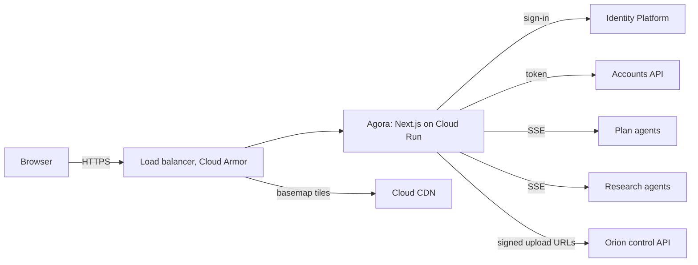
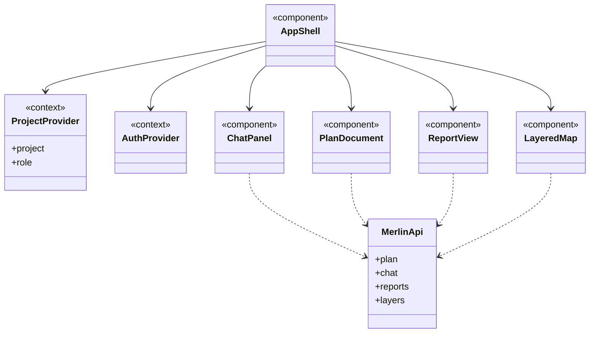

The workspace users see. It's where users start a Project, review its Plan, and ask questions once it's created.

## Data flow

## Software components

- **Next.js (React, TypeScript)**, App Router, on **Cloud Run**.
- **shadcn/ui** and **Tailwind CSS** for UI, **TanStack Query** for data.
- **Firebase Auth JS SDK**, **Vercel AI SDK** for streaming chat.
- **MapLibre GL JS** and **deck.gl** for the map, **React Flow** for graphs, **Vega-Lite** for charts.
- External HTTPS load balancer, **Cloud Armor**, **Cloud CDN**.

## Configuration and metadata

- The Next.js server is a thin backend-for-frontend: it adds the user's token and forwards to Merlin. It stores nothing.
- Content Security Policy locks scripts to Agora's own origin.
- Feature flags per company (for example, map 3D view) read from the Accounts API.

## UI components

- **App shell:** top bar with Project switcher and account menu, left nav: Chat, Plan, Report, Map.
- Each window is its own box in this diagram.

## Low-level design

