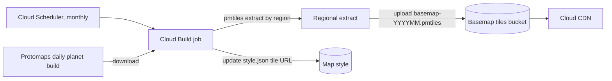
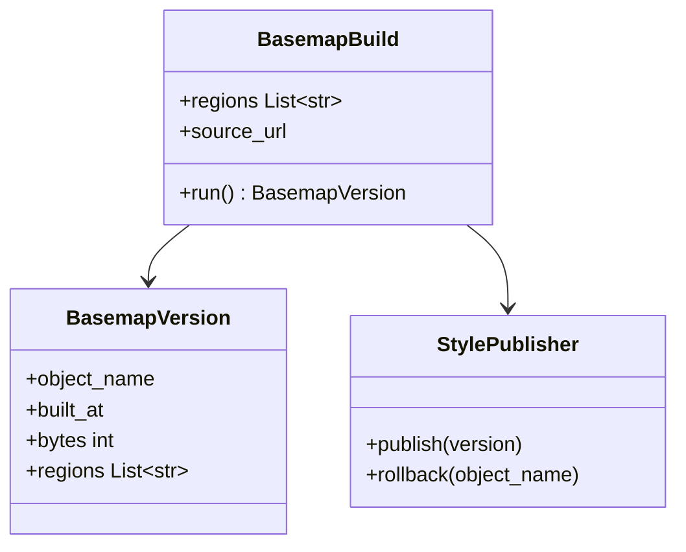

The background map under every Project's layers: streets, water, buildings and labels, stored as a single PMTiles file. It holds no customer data, so it can be cached publicly.

## Steps

- **Download:** the latest Protomaps OpenStreetMap build.
- **Extract:** only the regions FourthSpace customers need.
- **Publish:** upload under a new versioned name.
- **Switch:** point Agora's map style at the new file.

## Data flow

## Software components

- **Cloud Storage** bucket, served as a CDN backend bucket.
- **pmtiles** CLI to extract regions.
- **Protomaps basemap** OpenStreetMap build and its MapLibre style.
- **Cloud Build** job started monthly by **Cloud Scheduler**.

## Configuration and metadata

- Bucket: `agora-basemap`, public read for tile objects only, no other content.
- Object name: `basemap-YYYYMM.pmtiles`; the last 3 versions are kept for rollback.
- Regions: a list in the build config, such as UK and Ireland, extended when a company in a new region signs up.
- `style.json`: points at the current file, and sets fonts and sprite URLs.
- Attribution: "© OpenStreetMap contributors" shown on the map.

## Low-level design

