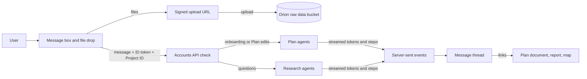
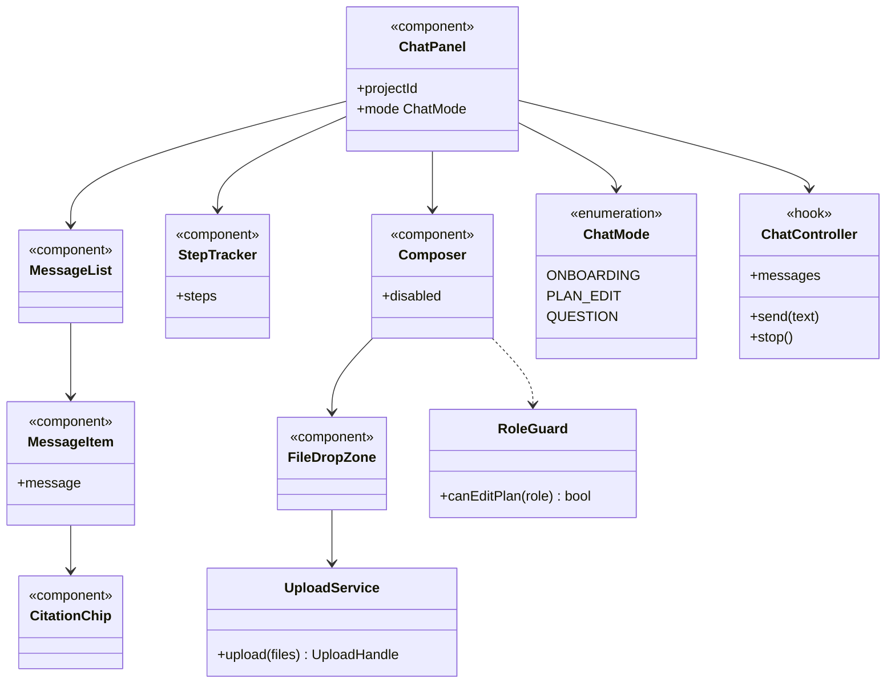

A simple chat field, used in three ways: onboarding a Project, editing its Plan, and asking questions once it's ready.

## Steps

- **Onboarding:** the user uploads raw data and describes the business problem.
- **Plan edits:** the user talks back and forth to change the Plan.
- **Questions:** once the Project is ready, the user asks about the decision, and answers stream back.

## Data flow

## UI components

- **Message thread:** user and agent messages, streamed as they arrive.
- **Step tracker:** shows the agent's current step, such as "Profiling data".
- **Composer:** text box, send button, and a drop zone for raw data files.
- **Upload progress:** one row per file, with size and status.
- **Suggested prompts:** starter questions for a new Project.
- **Citation chips:** link an answer to its sources in the report.
- **Role-aware state:** Viewers can ask questions but can't edit the Plan.

## Software components

- **Next.js (React, TypeScript)** with **shadcn/ui**.
- **Vercel AI SDK** `useChat` for streaming over server-sent events.
- **react-markdown** for agent messages.
- Uploads go straight to Cloud Storage with **signed URLs** from the Orion control API.

## Low-level design

- **ChatController** wraps `useChat` and picks the agent endpoint from `ChatMode`.
- **UploadService** asks for signed URLs and uploads in parallel, with retries.
- **RoleGuard** disables Plan edits for Viewers, but the Accounts API still checks every request.
