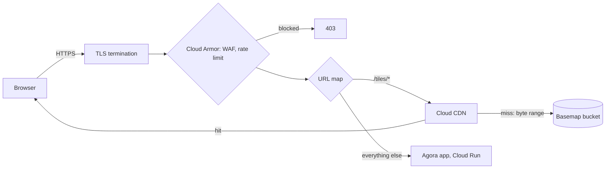
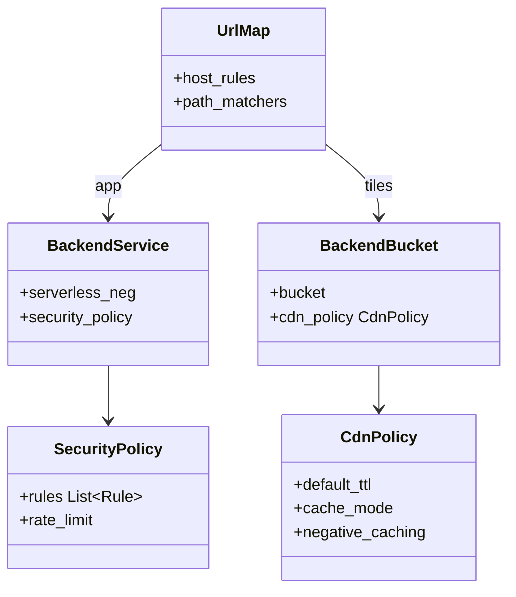

The single HTTPS entry point for Agora. It blocks bad traffic, routes requests, and caches basemap tiles close to users.

## Steps

- **TLS:** terminates HTTPS with a Google-managed certificate.
- **Protect:** Cloud Armor rules and rate limits.
- **Route:** app traffic to Cloud Run, tile requests to Cloud CDN.
- **Cache:** basemap tiles at the edge.

## Data flow

## Software components

- **Global External Application Load Balancer** with a serverless NEG for Cloud Run and a backend bucket for tiles.
- **Cloud Armor:** OWASP preconfigured rules, per-IP rate limiting, optional allow-list per company.
- **Cloud CDN** with cache mode `CACHE_ALL_STATIC`.

## Configuration and metadata

- Domain: `app.fourthspace.ai` (placeholder), Google-managed certificate, HTTP redirected to HTTPS.
- CDN: tiles cached 30 days; cache key ignores query strings; byte-range requests enabled for PMTiles.
- Each basemap build has a new file name, so no cache purge is needed.
- Rate limit: 600 requests per minute per IP on app routes; tiles not limited.
- Logging: load balancer logs sampled at 10%, Cloud Armor denials always logged.
- Security headers on app responses: HSTS and a strict Content Security Policy.

## Low-level design

- These are Terraform resources, not application classes: one module, `agora_edge`, defines them all.
