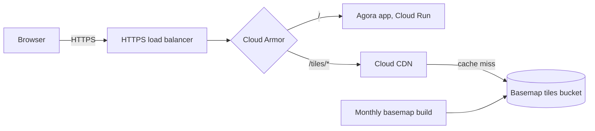

Serves Agora to users: one HTTPS entry point that routes to the Agora app and caches the basemap tiles at Google's edge. Runs in its own GCP project, `agora-prod`.

## Data flow

## Software components

- **External Application Load Balancer**, Google-managed TLS certificate.
- **Cloud Armor** security policy.
- **Cloud CDN** on a backend bucket.
- **Cloud Storage** for the basemap PMTiles.
- **Terraform** for all of it.

## Configuration and metadata

- Routes: `/tiles/*` to the basemap bucket through Cloud CDN, everything else to the Agora Cloud Run service.
- Only basemap tiles are cached. Project data, reports and map layers always go through Agora with the user's token.
