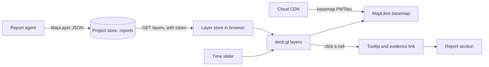
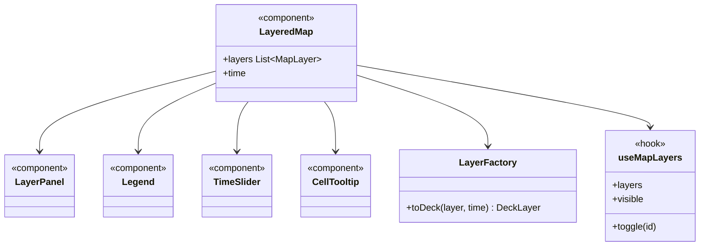

An interactive layered map built on the **MapLibre and Deck.gl** 3D map renderer, using **PMTiles** map tiles served from **Cloud CDN**.

## Displays

- Spacetime-H3 hexagon heatmaps at several resolutions.
- Candidate site markers.
- Model predictions over time.

## Data flow

## UI components

- **Map canvas:** pan, zoom, tilt for 3D extruded hexagons.
- **Layer panel:** toggle and reorder layers, opacity slider.
- **Legend:** colour scale per layer, with units.
- **Time slider:** steps through time buckets and prediction horizons, with play.
- **Cell tooltip:** H3 cell values and a link to the evidence in the report.
- **Compare mode:** split view, for example today against a scenario.

## Software components

- **MapLibre GL JS** with the **pmtiles** protocol, **Protomaps** basemap.
- **deck.gl** `H3HexagonLayer` and `ScatterplotLayer`, via `@deck.gl/mapbox` overlay.
- **h3-js** for cell maths in the browser.

## Configuration and metadata

- Basemap PMTiles in a public Cloud Storage bucket behind Cloud CDN, cached 30 days. Holds no customer data.
- Project layers are never on the CDN; they come from Merlin with the user's token.
- Each `MapLayer`: ID, kind, H3 resolution, cell values, colour scale, legend, evidence IDs.

## Low-level design

- `LayerFactory` turns each `MapLayer` kind into the right deck.gl layer, so new kinds are one new case.
