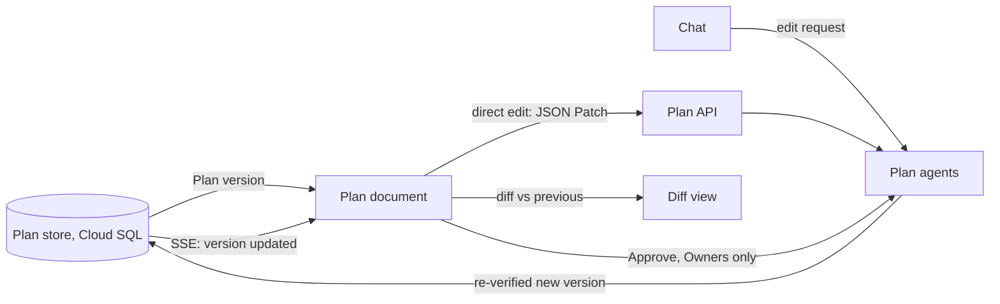
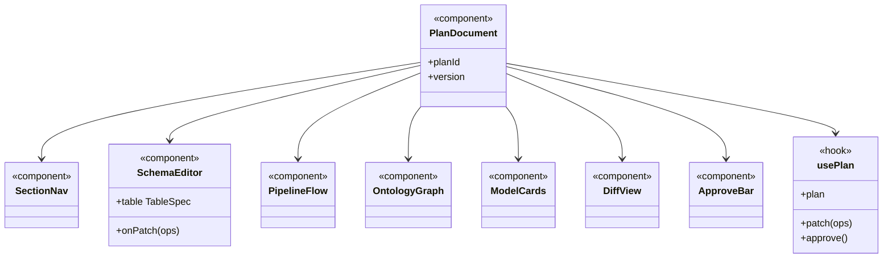

The Plan, shown as an interactive document. It works like editing a Deep Research plan or a coding agent's implementation plan.

## Sections

- **Golden Dataset schemas:** the proposed tables and columns, which the user can edit.
- **Raw to Gold flowchart:** the steps of the pipeline.
- **Ontology graph:** object types and links, shown visually.
- **AI models:** what each model predicts and how it's trained.

The Plan is stored in Cloud SQL. The user can edit the document directly or ask for changes in the chat, then approve it to create the Project.

## Data flow

## UI components

- **Section nav:** sticky list of sections with verification status badges.
- **Schema editor:** editable table per Gold table: column name, type, derivation, source columns.
- **Pipeline flowchart:** stages as nodes, raw datasets to Gold tables.
- **Ontology graph:** object types as nodes, links as edges, click for properties.
- **Model cards:** target, features, template, metric, CPU or GPU.
- **Regulations panel:** the rules in force, each linked to its source passage.
- **Diff view:** what changed since the last version, with the agent's explanation.
- **Verification badge:** passed, running or failed, with the report.
- **Approve bar:** approve button for Owners, disabled while verification runs.

## Software components

- Next.js page, **shadcn/ui**, **TanStack Table** for the schema editor.
- **React Flow** for the pipeline flowchart and Ontology graph, **elkjs** for layout.
- **fast-json-patch** for edits; server-sent events for updates.

## Configuration and metadata

- The document renders a `Plan` JSON version; it never holds its own copy.
- Edits are JSON Patches against a version number; a stale version is rejected and reloaded.
- Viewers read only; Editors edit; Owners also approve.

## Low-level design

