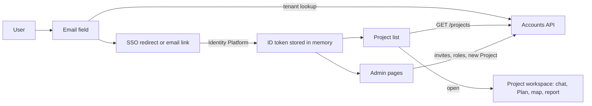
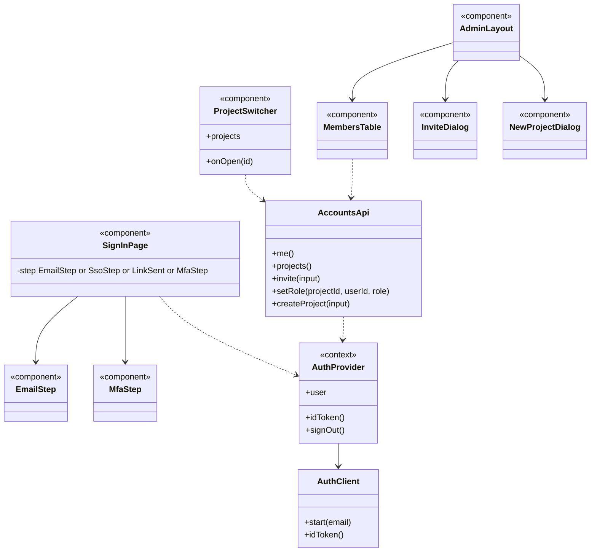

The screens a user sees before and around a Project: signing in, picking a Project, and, for company admins, managing people and Projects.

## Steps

- **Sign in:** email first, then company SSO or an email link.
- **Projects:** lists the Projects the user is a member of.
- **Admin:** invite users, create Projects, set roles.

## Data flow

## UI components

- **Sign-in card:** email input, "Continue" button, SSO redirect, email-link sent state, MFA code input.
- **Project switcher:** searchable list with each Project's status and the user's role.
- **Members table:** name, email, role dropdown, remove button.
- **Invite dialog:** email list, role, optional Project.
- **New Project dialog:** name and description, then opens the chat for onboarding.
- **Account menu:** company name, user, sign out.

## Software components

- **Next.js (React, TypeScript)** on Cloud Run, behind the HTTPS load balancer.
- **shadcn/ui** components with **Tailwind CSS**.
- **Firebase Auth JS SDK** for sign-in, **TanStack Query** for API calls.

> **To confirm:** Agora's frontend stack. Next.js with shadcn/ui is assumed here and in the other Agora boxes.

## Low-level design

- **AuthProvider** is a React context. Every component gets the user and token from it.
- **AccountsApi** is one typed client class that adds the token to every call. Components use it through TanStack Query hooks.
- **SignInPage** is a small state machine: email, then SSO or email link, then MFA.
