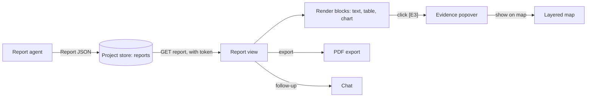
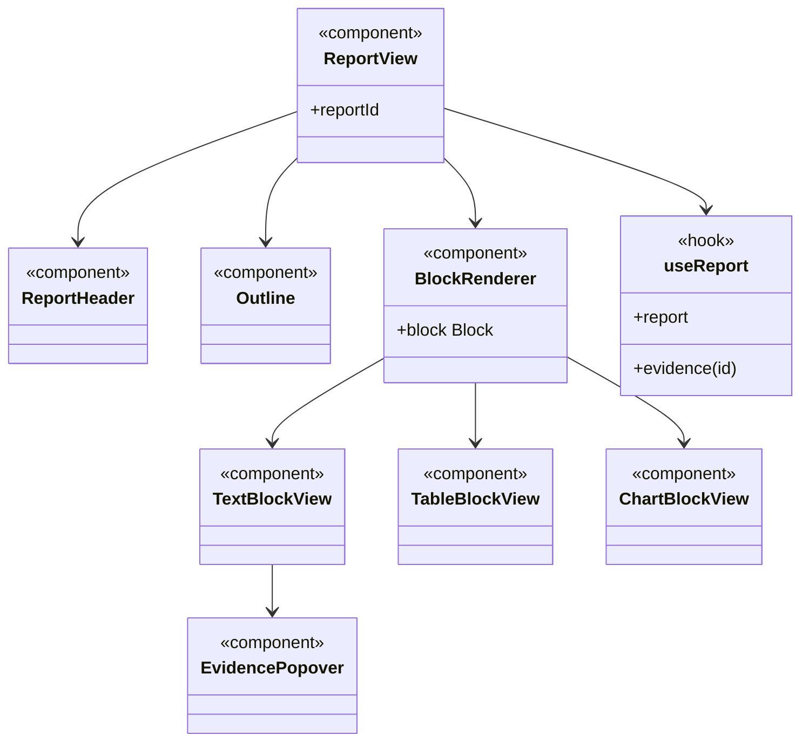

Shows the deep research document the Report agent writes: findings, tables, charts and the sources behind each claim.

## Data flow

## UI components

- **Report header:** question, date, short answer.
- **Outline:** section list for jumping around.
- **Blocks:** text with citation chips, sortable tables, charts.
- **Evidence popover:** the query or scenario behind a claim, with its summary and "show on map".
- **Sources list:** every evidence item used.
- **Report history:** earlier answers in this Project.
- **Export:** PDF and CSV for tables.

## Software components

- Next.js page, **shadcn/ui**.
- **react-markdown** for text blocks, **TanStack Table** for tables, **react-vega** for Vega-Lite charts.
- PDF export with headless Chrome on a Cloud Run job.

## Configuration and metadata

- Renders the stored `Report` JSON; reports are read-only once written.
- Each report: ID, question, Plan version, model versions, evidence IDs, created at, created by.

## Low-level design

- `BlockRenderer` picks a view per block type, matching the Report agent's `Block` classes.
