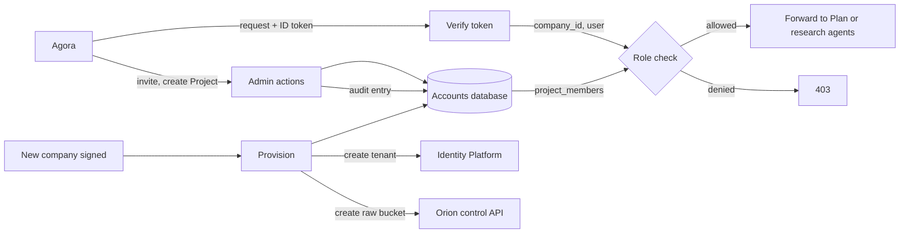
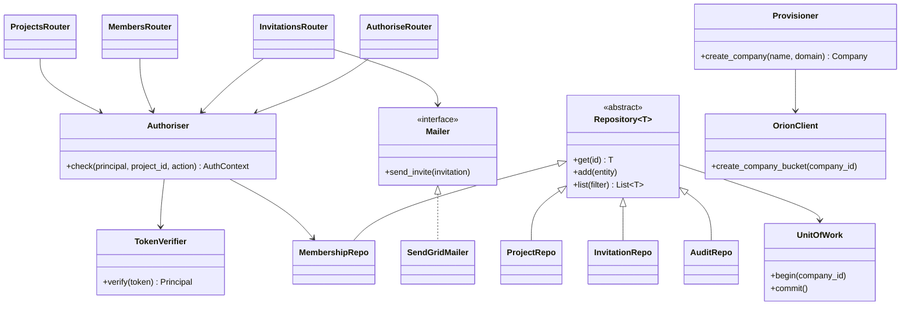

The single place Merlin decides who may do what. Agora sends the user's ID token with every request, and the Accounts API checks it before any agent runs.

## Steps

- **Verify:** checks the ID token's signature, expiry and tenant.
- **Authorise:** looks up the user's role on the Project.
- **Manage:** invites users, creates Projects, changes roles.
- **Provision:** sets up a new company's tenant and Orion bucket.

## Data flow

## Software components

- **Python 3.12, FastAPI**, on **Cloud Run**.
- **Firebase Admin SDK** to verify tokens and manage tenants.
- **Cloud SQL Python Connector** with IAM database auth, **SQLAlchemy** models.
- **SendGrid** for invitation emails.
- **OpenTelemetry** traces to Cloud Trace.

## Configuration and metadata

- Cloud Run: min 1 instance, internal ingress behind the external HTTPS load balancer, Cloud Armor rules.
- Own service account. Can call Orion's control API only to create company buckets.
- Every request sets the Postgres session variable `app.company_id`, which row-level security uses.
- Endpoints: `/me`, `/companies`, `/projects`, `/projects/{id}/members`, `/invitations`, `/authorise`.
- Agents call `/authorise` with the user's token and Project ID before acting.

## Low-level design

- **Routers** are thin. All rules live in `Authoriser` and the repositories.
- **UnitOfWork** opens each transaction and sets `app.company_id`, so row-level security always applies.
- **Repository** pattern keeps SQL out of the routers and makes them testable with fakes.
- Every write also adds an `AuditRepo` entry in the same transaction.
