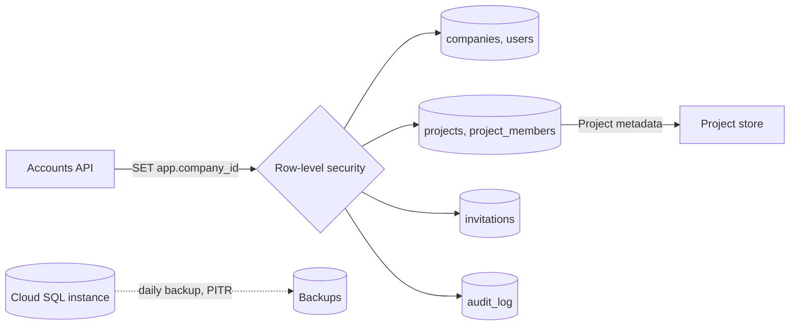
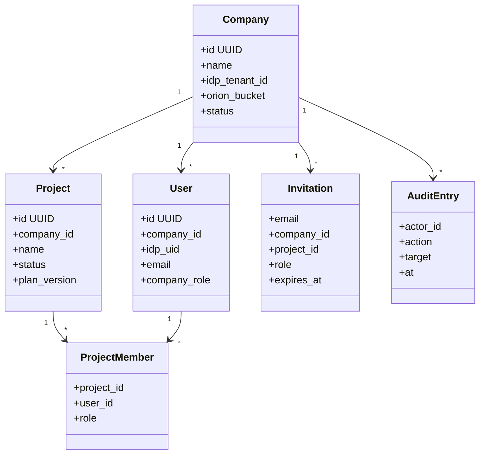

A Cloud SQL for PostgreSQL database that holds every company, user, Project and role, plus the Project metadata the rest of Merlin needs.

## Steps

- **Tenancy:** companies and their users.
- **Projects:** each Project, its status and its members' roles.
- **Invitations:** pending invites, with expiry.
- **Audit:** every sign-in, invite and role change.

## Data flow

## Configuration and metadata

- Cloud SQL for PostgreSQL 16, regional high availability, private IP only.
- Automated daily backups and point-in-time recovery, 14 days.
- Encrypted with a customer-managed key (CMEK).
- IAM database auth, no passwords. The Accounts API has read-write access; agents have none.
- Row-level security on `company_id` in every table, so one company never sees another's rows.

## Tables

- `companies`: id, name, `idp_tenant_id`, `orion_bucket`, status.
- `users`: id, `company_id`, `idp_uid`, email, name, `company_role`.
- `projects`: id, `company_id`, name, status, current Plan version, created by.
- `project_members`: `project_id`, `user_id`, role (owner, editor, viewer).
- `invitations`: email, `company_id`, optional `project_id`, role, expiry.
- `audit_log`: actor, action, target, time.

## Software components

- **Cloud SQL for PostgreSQL 16**.
- **Alembic** for schema migrations, run by Cloud Build on deploy.

## Low-level design

- These are the **SQLAlchemy models** the Accounts API uses. Alembic migrations are generated from them.
- Every model has `company_id`, either directly or through its Project, for row-level security.
