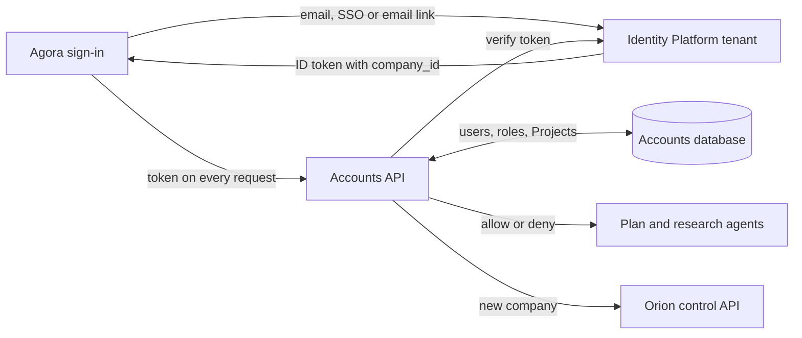
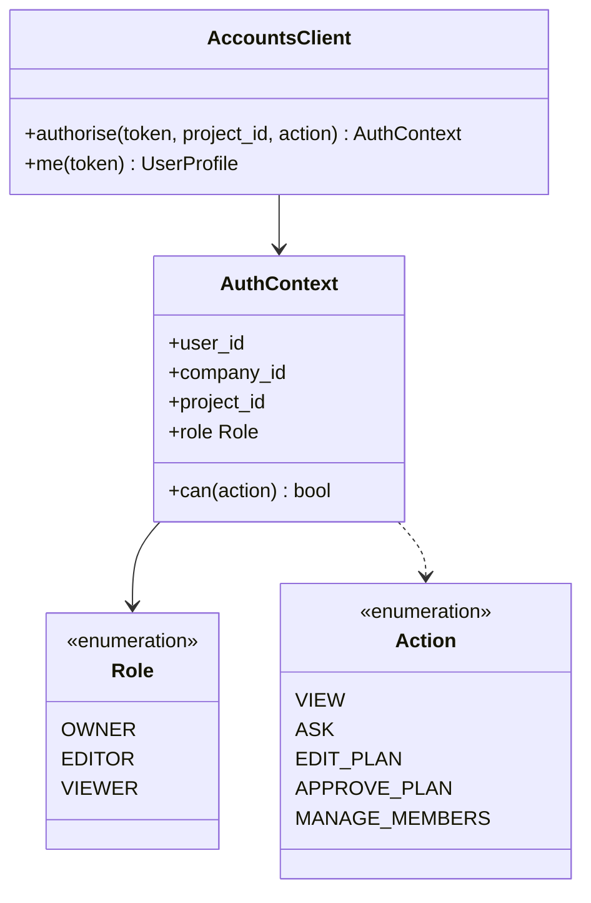

Who can sign in, which company they belong to, and which Projects they can open. Every call from Agora into Merlin is checked here first.

## Steps

- **Sign in:** Identity Platform, one tenant per customer company.
- **Authorise:** the Accounts API checks the user's company and Project role.
- **Record:** companies, users, Projects and memberships live in Cloud SQL.

## Data flow

## Tenant model

- **Company** = tenant. Own Identity Platform tenant, own Orion raw data bucket.
- **Project** belongs to one company.
- **Members** join a Project with a role: Owner, Editor or Viewer.
- Company admins invite users and create Projects.

## Low-level design

The contract every Merlin service uses to check access. The classes inside are in each child box.

- Shared as a small Python package, `fourthspace-auth`, used by the agents and the Accounts API.
- **Role → Action** mapping: Viewer can view and ask; Editor can also edit the Plan; Owner can also approve and manage members.
