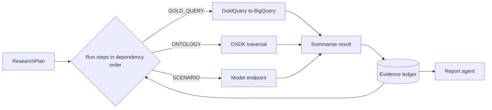
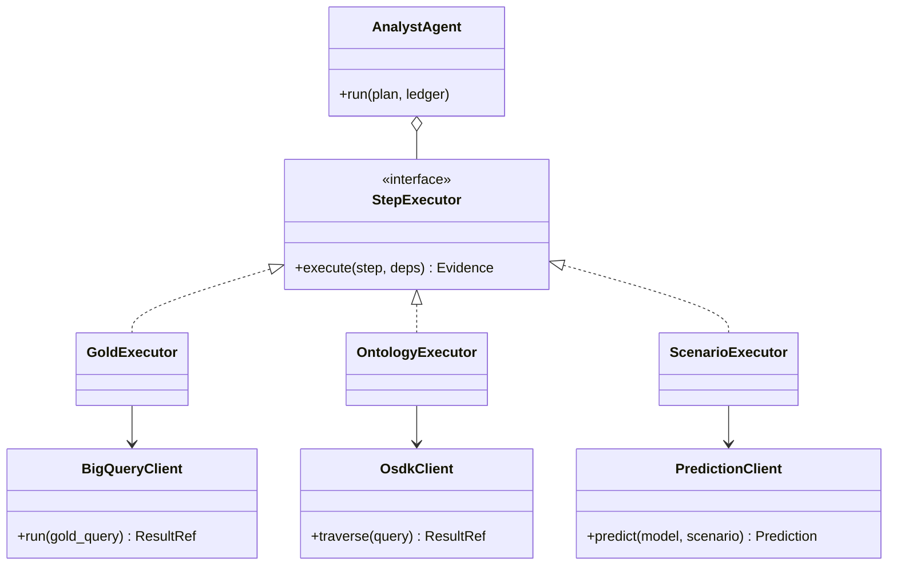

Runs each step of the research plan.

## Steps

- **Golden Datasets:** range scans and aggregates by Spacetime-H3 cell.
- **Ontology:** follows object links, such as from a candidate site to the areas it serves.
- **Models:** runs predictions for "what if" questions.

## Data flow



## Software components

- ADK `LlmAgent`, Gemini 4 Argon.
- Tools: `query_gold` (BigQuery, read-only, per-Project dataset), `query_ontology` (OSDK), `predict` (Vertex AI endpoint).
- **BigQuery** with a bytes-billed cap per query.

## Prompting and context engineering

- **Typed tools only:** the model fills `GoldQuery` and `Scenario` objects; it never writes raw SQL.
- **Context per step:** the step's intent, the columns of the tables it needs, and the evidence from the steps it depends on.
- **Small results:** tools return a summary and a stored data reference, not thousands of rows.
- **Retry once:** on an empty or failed query, adjust filters once, then record "no data" as evidence.

## Prompt (excerpt)

```text
Run step {step_id}: "{intent}".
Tables you may use: {table_columns}. Earlier evidence: {deps}.
Call exactly one of query_gold, query_ontology or predict.
Do not interpret beyond the result; summarise it in one sentence
with the key numbers.
```

## Low-level design


