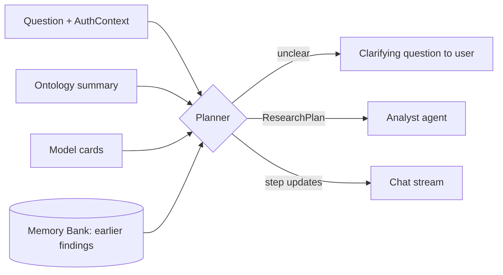
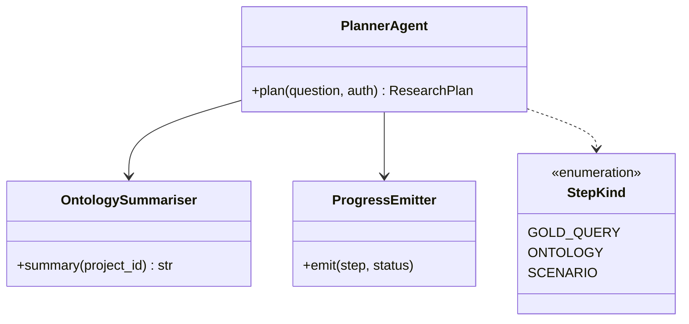

Receives the user's question from Agora and breaks it into steps the Analyst can run. It streams progress and the final answer back to the chat.

## Data flow



## Software components

- ADK `LlmAgent`, Gemini 4 Argon.
- Tools: `ontology_summary`, `list_models`, `recall_findings`, `ask_user`, `emit_progress`.

## Prompting and context engineering

- **Context:** the question, a compact Ontology summary (object types, links, key metrics), model cards, and recalled findings. No table data.
- **Plan shape:** 2 to 8 steps, each a Gold query, an Ontology traversal or a model scenario, with dependencies.
- **Ask, don't guess:** if the place, time range or goal is unclear, ask one clarifying question.
- **Output:** strict JSON `ResearchPlan`, plus a short progress line for the user.

## Prompt (excerpt)

```text
Break the user's question into 2-8 steps the Analyst can run.
Available data: {ontology_summary}. Models: {model_cards}.
Earlier findings: {recalled}.
Each step is GOLD_QUERY, ONTOLOGY or SCENARIO, with depends_on.
If the place, time range or goal is unclear, call ask_user once.
Return ResearchPlan JSON only.
```

## Low-level design


