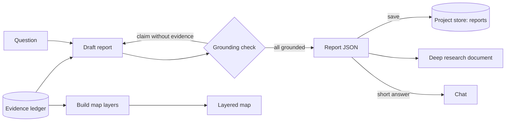
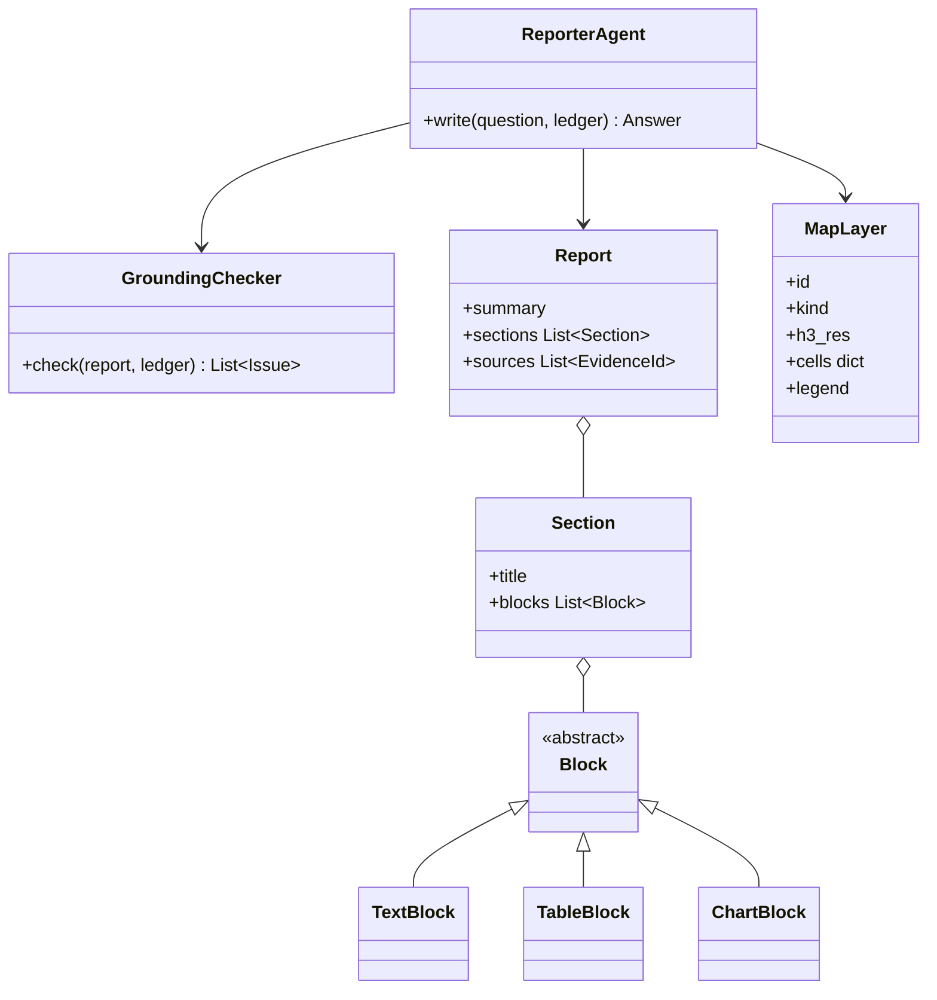

Checks that every claim in the answer is backed by a query result, then writes the outputs.

## Outputs

- A deep research document with findings, tables and sources.
- Map layers, such as hexagon heatmaps and candidate site markers.

## Data flow



## Software components

- ADK `LlmAgent`, Gemini 4 Argon.
- A deterministic **grounding checker** that matches every number and claim to an evidence ID.
- **Vega-Lite** chart specs; map layers as H3 cell lists with values.

## Prompting and context engineering

- **Context:** the question and the evidence ledger summaries with IDs. Raw rows only for tables the report will show.
- **Cite everything:** every sentence with a fact carries `[E3]`-style evidence IDs.
- **Checker in the loop:** the draft goes through the grounding checker; ungrounded claims are sent back to be removed or fixed, up to 2 rounds.
- **Structure:** short answer first, then findings, tables, charts, method, limitations.

## Prompt (excerpt)

```text
Answer: "{question}" using only this evidence: {ledger}.
Every factual sentence must cite evidence IDs like [E3].
Start with a 2-sentence answer, then findings, tables, charts,
method and limitations. Propose map layers from evidence with H3 cells.
Return Report JSON only.
```

## Low-level design


