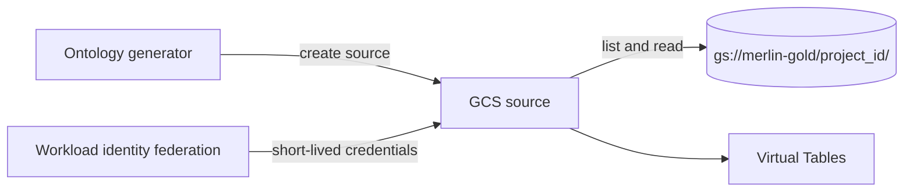
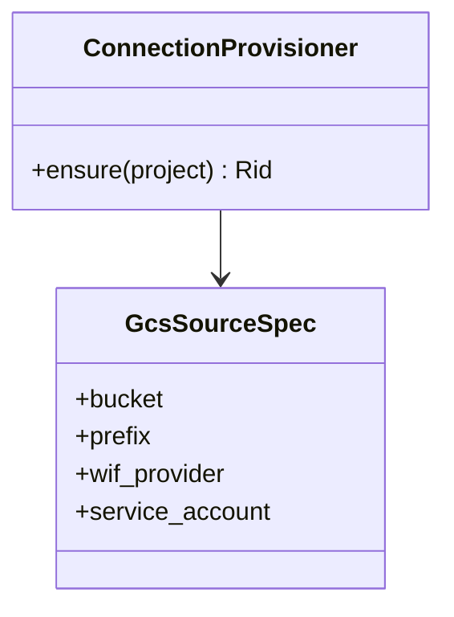

A Foundry data connection to the Project's Golden Datasets in Cloud Storage. Each Project gets its own connection, scoped to its own datasets.

## Data flow

## Software components

- **Foundry Data Connection**, Google Cloud Storage source.
- **GCP Workload Identity Federation**, so Foundry gets short-lived credentials and no service account key is stored.

## Configuration and metadata

- Scope: the Project's Gold prefix only, read-only.
- GCP principal: `foundry-{project_id}`, role `storage.objectViewer` on that prefix.
- Network: Foundry egress IPs allow-listed in Merlin's perimeter.
- Metadata kept in the Plan store: source RID, bucket, prefix, created at.

## Low-level design

