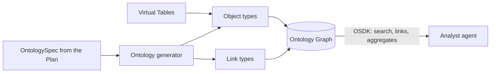
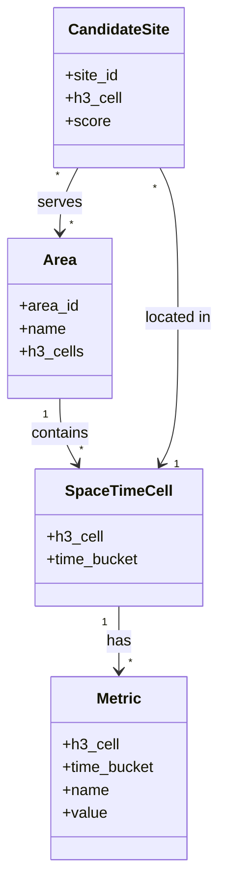

The Project's Ontology Graph: a semantic view of the Golden Datasets that agents can reason over.

The Ontology architect designs it during the Plan, and it's generated automatically once the Golden Datasets are stored. When new Golden Data arrives, the Ontology updates with it.

## Example object types

- **Area:** a region the decision covers.
- **Space-Time Cell:** an H3 hexagon in a time bucket.
- **Metric:** a derived signal for a cell, such as footfall.
- **Candidate Site:** a possible location for the decision.

## Data flow

## Software components

- **Foundry Ontology**: object types, link types, properties.
- **OSDK** (Python) generated for each Project's Ontology.

## Configuration and metadata

- API names in `PascalCase`, matching the OntologySpec.
- Each object type: backing virtual table, primary key, title property, description.
- Links only on key columns from the GoldSpec.
- Version recorded in the Plan store with the Plan version that made it.

## Low-level design

- This is the example Ontology; each Project's real one comes from its Plan.
