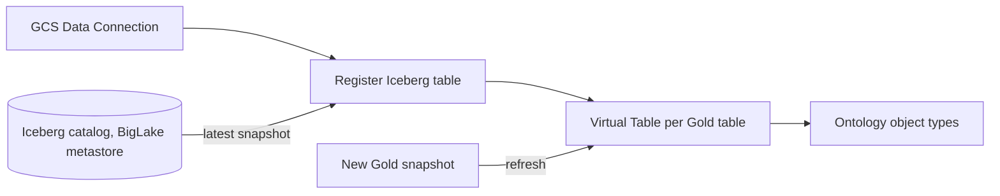
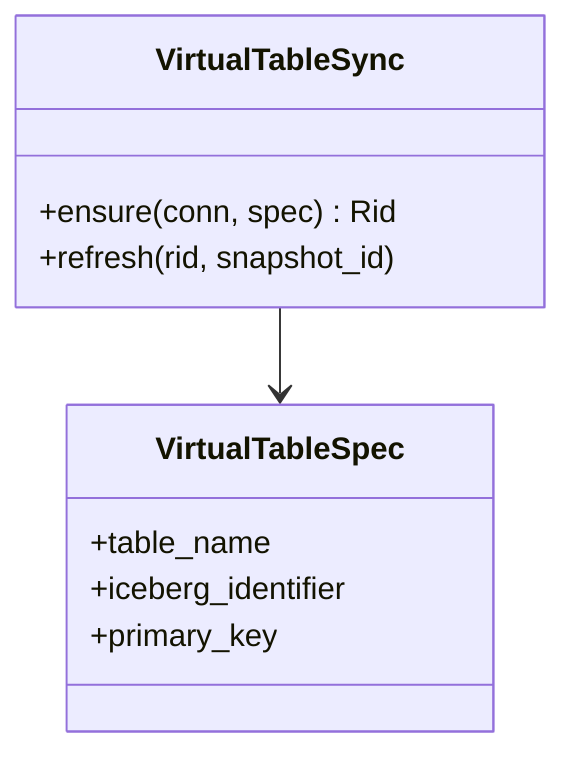

Virtual Tables let Foundry read the Golden Datasets where they are, so there's only one copy of the data and it's always current.

## Data flow

## Software components

- **Foundry Virtual Tables** over Apache Iceberg.
- **BigLake metastore** as the Iceberg catalog.

## Configuration and metadata

- One virtual table per Gold table, same name as in the GoldSpec.
- Reads the latest Iceberg snapshot; the snapshot ID is recorded on each Ontology sync.
- Schema changes come from a new Plan version only; the generator updates the table then.

## Low-level design

