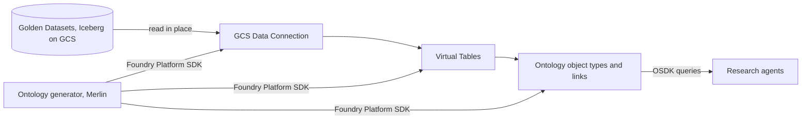
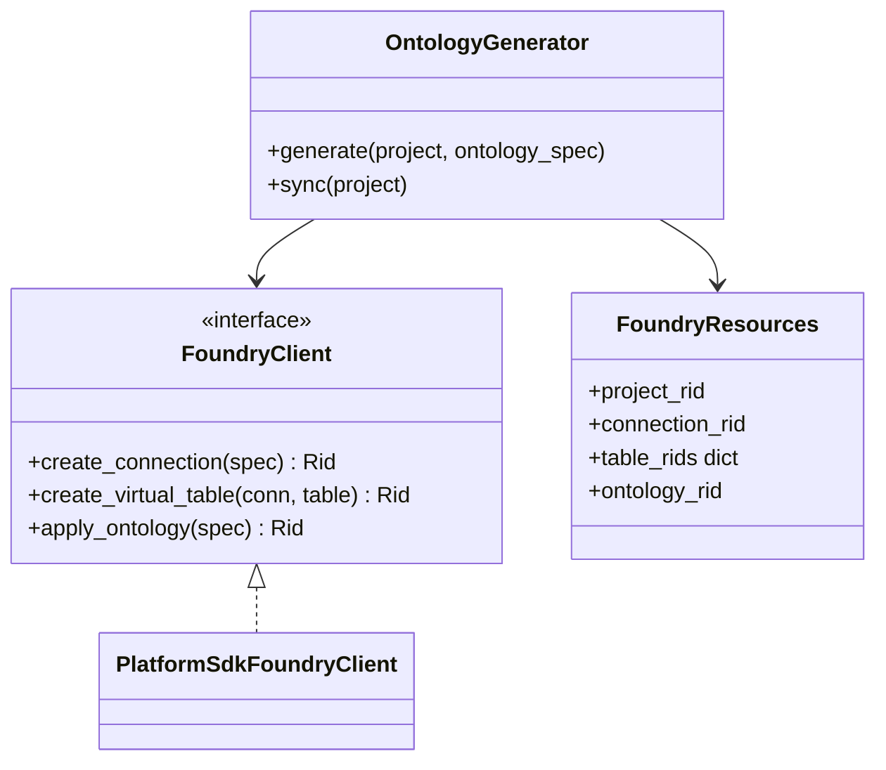

Palantir Foundry holds each Project's Ontology Graph. Foundry reads the Golden Datasets in place, with no copy, and the Ontology is generated automatically once they're stored.

## Steps

- **GCS Data Connection:** points at the Project's Golden Datasets.
- **Virtual Tables:** expose them to Foundry without copying.
- **Ontology Graph:** object types and links from the Plan, backed by the virtual tables.

## Data flow

## Software components

- **Palantir Foundry** (FourthSpace enrolment), one Foundry project per FourthSpace Project.
- **Foundry Platform SDK** (Python) used by Merlin's Ontology generator.
- **Ontology SDK (OSDK)**, Python, generated per Ontology, used by the research agents.

## Configuration and metadata

- Foundry project name: `fs-{company_id}-{project_id}`.
- Access: one Foundry service user per Project, read-only for agents. No end users log in to Foundry.
- The generator records Foundry resource IDs (connection, tables, ontology) in the Plan store.
- Deleting a Project deletes its Foundry project.

## Low-level design

- `OntologyGenerator` is idempotent: running it again only applies what changed.
