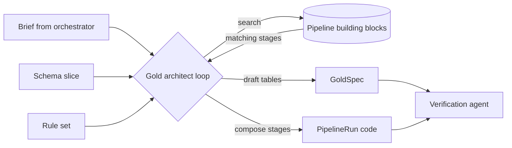
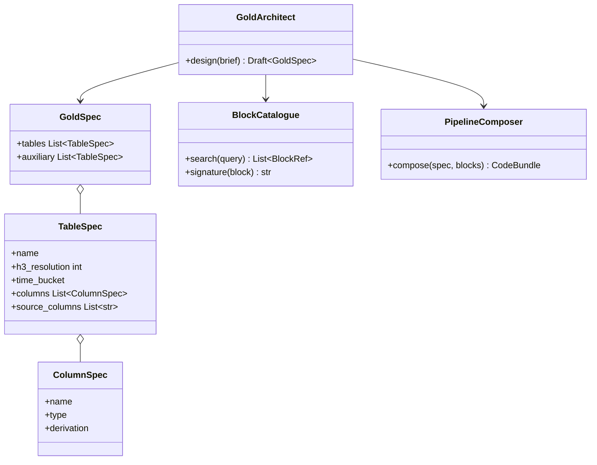

Designs the Golden Datasets and the pipeline that builds them. It assembles the pipeline from FourthSpace's pre-written data pipeline building blocks.

## Outputs

- A list of proposed tables and their columns, indexed with Spacetime-H3.
- Auxiliary datasets that add context to the primary Golden Dataset.
- The PySpark code that turns the raw data into the Golden Datasets, built from the building blocks.

## Data flow



## Software components

- ADK `LlmAgent` on Agent Engine, Gemini 4 Argon.
- Tools: `search_blocks`, `get_block_signature`, `propose_tables`, `compose_pipeline`, `lint_code`.
- Output: a `GoldSpec` and a `PipelineRun` Python module.

## Prompting and context engineering

- **Context:** the brief, only the raw columns relevant to the decision, the machine rule set, and the H3 resolution guide.
- **Blocks first:** must call `search_blocks` before writing any stage; new stages need a written reason.
- **Design rules in prompt:** every table keyed by H3 cell and time bucket; no direct identifiers in any Gold column; aggregate to at least k = 10.
- **Output:** strict JSON `GoldSpec`, then code generated from it, so the spec and code can't drift.

## Prompt (excerpt)

```text
You design Golden Datasets for: "{problem_statement}".
Raw columns available: {schema_slice}
Rules you must satisfy: {rule_set}
Every table is keyed by (h3_cell, time_bucket). Pick the coarsest
H3 resolution that still answers the question.
Search the building blocks before writing any stage. If none fits,
explain why in "rationale".
Return GoldSpec JSON only.
```

## Low-level design


