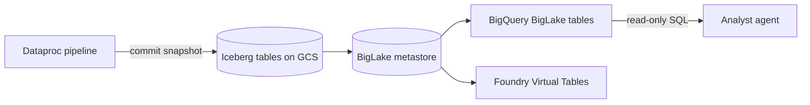
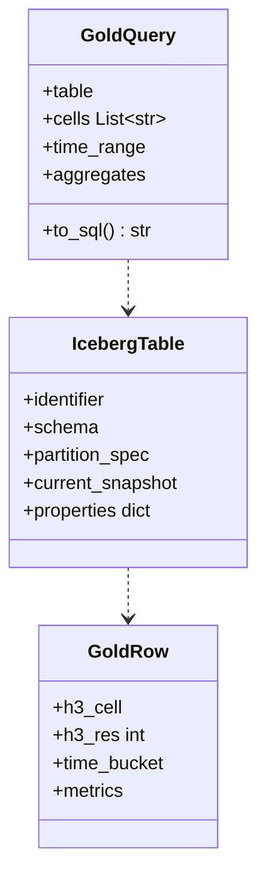

The Project's Golden Datasets: tables of derived metrics that strongly influence the decision.

## Properties

- Small compared with the raw data.
- Compliant with GDPR and the Project's other regulations.
- Indexed with Spacetime-H3.
- Stored as Apache Iceberg tables.
- Include auxiliary datasets that add context to the primary one.

## Data flow

## Software components

- **Apache Iceberg** tables on Cloud Storage, Parquet files.
- **BigLake metastore** catalog.
- **BigQuery** BigLake Iceberg tables for the agents' SQL.

## Configuration and metadata

- Partitioned by `h3_res`, then `time_bucket` day; sorted by `h3_cell`.
- Every table has `h3_cell`, `h3_res`, `time_bucket` and the metric columns from the GoldSpec.
- Table properties: Plan version, pipeline run ID, source datasets, row count, anonymisation level.
- Snapshots kept for 30 days for time travel and rollback.
- Agents get a read-only BigQuery dataset per Project.

## Low-level design

- Agents build `GoldQuery` objects rather than raw SQL, so every query is parameterised and Project-scoped.
