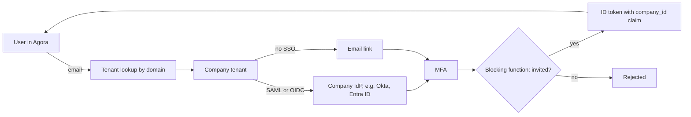
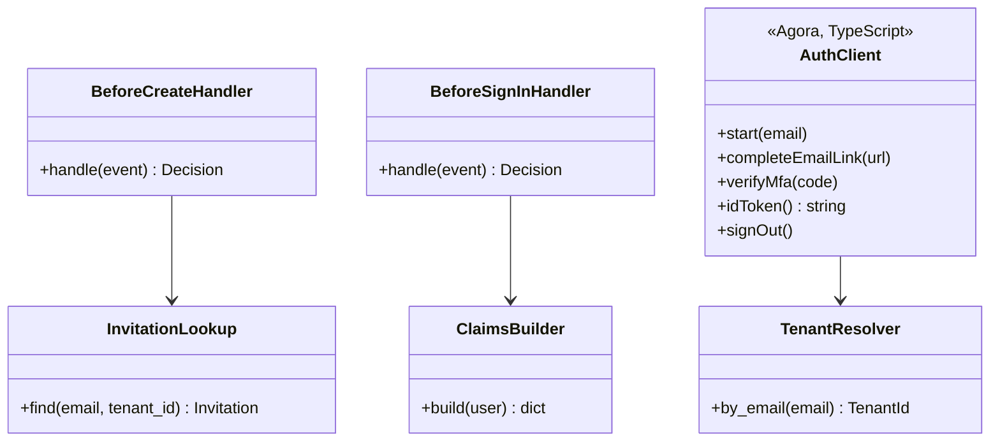

GCP Identity Platform signs users in. Each customer company is its own tenant, so sign-in settings and users never mix between companies.

## Steps

- **Find tenant:** maps the user's email domain to their company's tenant.
- **Authenticate:** company SSO or a one-time email link, then MFA.
- **Gate:** only invited users can create an account.
- **Issue token:** a short-lived ID token carrying `company_id`.

## Data flow

## Software components

- **GCP Identity Platform** with multi-tenancy enabled.
- **Firebase Auth JS SDK** in Agora for the sign-in screens.
- **Blocking functions** on Cloud Run functions: `beforeCreate` checks the invitation, `beforeSignIn` adds custom claims.

## Configuration and metadata

- One tenant per company, ID stored in `companies.idp_tenant_id`.
- Providers per tenant: SAML or OIDC SSO, or email link. No passwords.
- MFA required for every tenant (TOTP).
- ID token lifetime 1 hour, refreshed silently. Refresh tokens revoked when a user is removed.
- Custom claims: `company_id`, `company_role` (admin or member). Project roles are not in the token; the Accounts API checks them live.
- Sign-in and admin events go to Cloud Audit Logs.

## Low-level design

- The two **blocking function handlers** are small classes, one per Identity Platform event.
- **TenantResolver** is served by the Accounts API so Agora never holds a list of tenants.
- **AuthClient** wraps the Firebase Auth SDK in Agora, so screens never call the SDK directly.
