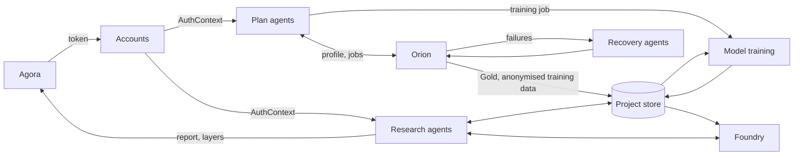
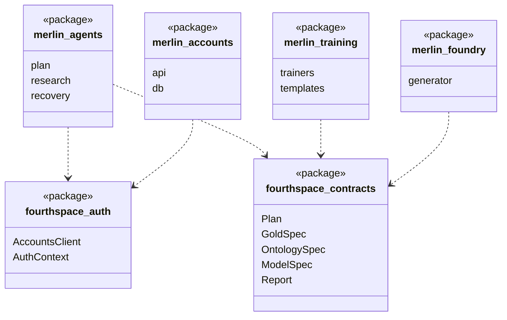

FourthSpace's core platform on GCP. Merlin plans and creates each Project, stores everything the Project owns, and runs the agents that answer users' questions.

## Responsibilities

- Signs users in and manages companies, users and Projects.
- Plans a Project with ReAct agents.
- Sends approved code to Orion to run.
- Trains the models on CPU or GPU, on anonymised data.
- Stores the Golden Datasets and models, and generates the Ontology.
- Answers questions with research agents.

## Data flow

## Software components

- GCP project `merlin-prod`, inside a VPC Service Controls perimeter.
- **Vertex AI Agent Engine** (Plan, research and recovery agents), **Vertex AI Training**, **Model Registry**, **endpoints**.
- **Cloud SQL for PostgreSQL** (accounts and Plan store), **Cloud Storage**, **BigLake metastore**, **BigQuery**.
- **Cloud Run** (Accounts API, test runner, triggers), **Pub/Sub**, **Identity Platform**.
- **Terraform** and **Cloud Build** for deploys; **Cloud Monitoring** dashboards and alerts.

## Low-level design

- One monorepo. `fourthspace-contracts` holds every shared Pydantic model, so agents, training and Foundry agree on shapes.
