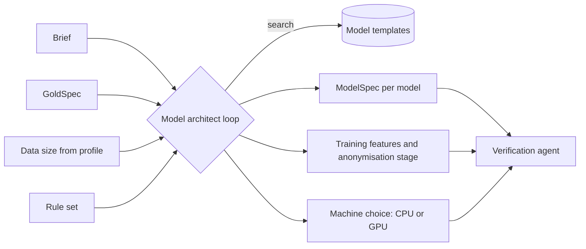
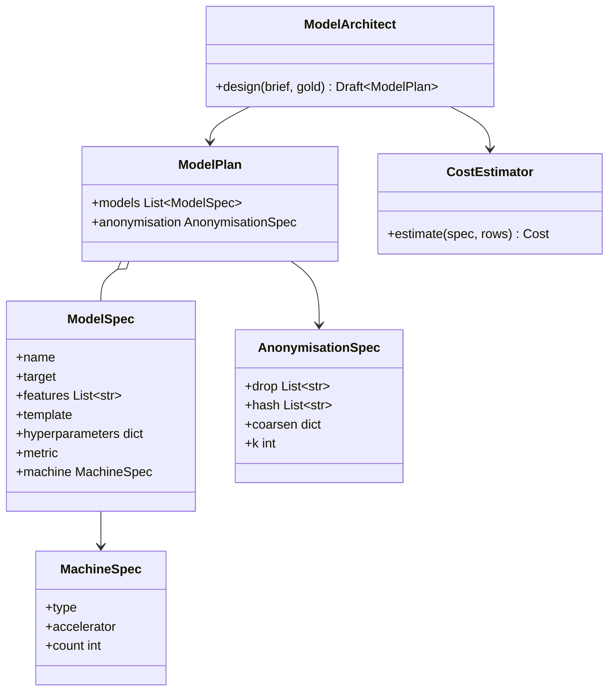

Designs the Project's predictive models from a collection of existing architectures, from linear regressions to time-series transformers.

## Outputs

- The chosen architectures and what each one predicts.
- The processing that turns the raw data into anonymised training data, run inside Orion.
- PyTorch and scikit-learn training code, assembled from FourthSpace's pre-written model training building blocks, to run on CPU or GPU on Vertex AI.
- The machine type for each model: CPU for classical models, GPU for deep ones.

## Data flow



## Software components

- ADK `LlmAgent` on Agent Engine, Gemini 4 Argon.
- Tools: `search_model_templates`, `estimate_cost`, `propose_models`, `compose_training`.
- Templates come from the FourthSpace training building blocks.

## Prompting and context engineering

- **Context:** the decision, the GoldSpec, the data size, the rule set, and the template catalogue with each template's strengths.
- **Simplest first:** prefer a linear or gradient-boosting model; propose a deep model only if the question needs sequences or many interacting signals, and say why.
- **Anonymised only:** training features may only use columns that pass the anonymisation stage.
- **Cost-aware:** must call `estimate_cost` before choosing a GPU.
- **Output:** strict JSON `ModelSpec` list, each with target, features, template, hyperparameters, metric and machine.

## Prompt (excerpt)

```text
Propose predictive models for: "{problem_statement}".
Gold tables: {gold_spec}. Training rows: about {row_count}.
Use templates from: {templates}. Start with the simplest model that
can answer the question. Use a GPU only for deep models, after
calling estimate_cost. Train only on anonymised features.
Return a list of ModelSpec JSON only.
```

## Low-level design


