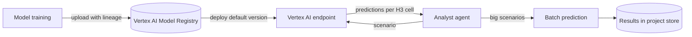
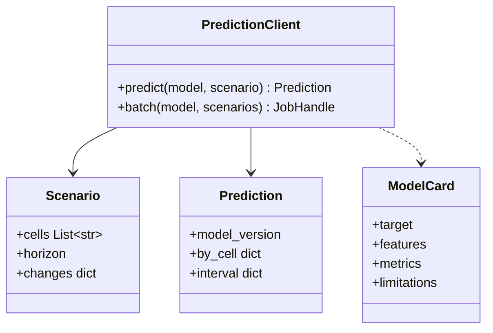

The Project's trained predictive models, from linear regressions to time-series transformers.

They predict how the state of a Spacetime-H3 hexagon changes over time. For example, an area's health if 2 buses are placed on a street, or a crop's quality if it doesn't rain for 3 weeks.

Research agents call the models to answer "what if" questions.

## Data flow

## Software components

- **Vertex AI Model Registry** for versions, aliases and lineage.
- **Vertex AI online endpoints** with prebuilt PyTorch and scikit-learn serving containers.
- **Vertex AI batch prediction** for large scenarios.

## Configuration and metadata

- One endpoint per Project, CPU machines; scale to zero after an idle period.
- Aliases: `default` used by agents, `candidate` for a newly trained version.
- Each model version: Plan version, training data hash, code commit, metrics, machine, model card.
- Input and output schemas registered with the model, so agents know which features a scenario needs.

## Low-level design

- `Scenario.changes` holds the "what if", such as "2 extra buses on street X".
