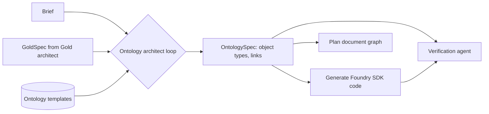
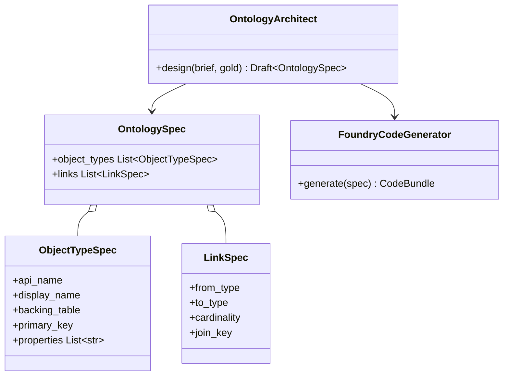

Designs the Project's Ontology for the Palantir Foundry Ontology platform.

## Outputs

- Object types, each backed by a Golden Dataset table.
- The links between object types.
- The code that creates the Ontology once the Golden Datasets exist.

The Plan document shows the design as an interactive graph.

## Data flow



## Software components

- ADK `LlmAgent` on Agent Engine, Gemini 4 Argon.
- Tools: `get_gold_spec`, `search_templates`, `propose_ontology`, `generate_foundry_code`.
- Generated code uses the **Foundry Platform SDK** (Python).

## Prompting and context engineering

- **Context:** the GoldSpec (tables and columns only), the problem statement, and reusable templates such as Area, Space-Time Cell, Metric, Candidate Site.
- **Rules:** every object type must be backed by exactly one Gold table and have a primary key; links only on real key columns.
- **Naming:** business names the user will recognise, with a one-line description each.
- **Output:** strict JSON `OntologySpec`; code is generated from it, not written freehand.

## Prompt (excerpt)

```text
Design a Foundry Ontology over these Golden Datasets: {gold_spec}
The user's decision: "{problem_statement}"
Start from these templates where they fit: {templates}
Each object type maps to one table and one primary key.
Links must join on existing key columns.
Return OntologySpec JSON only.
```

## Low-level design


