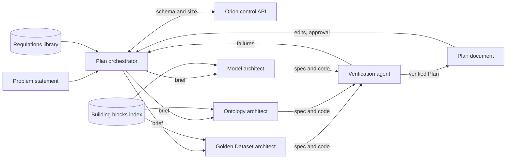
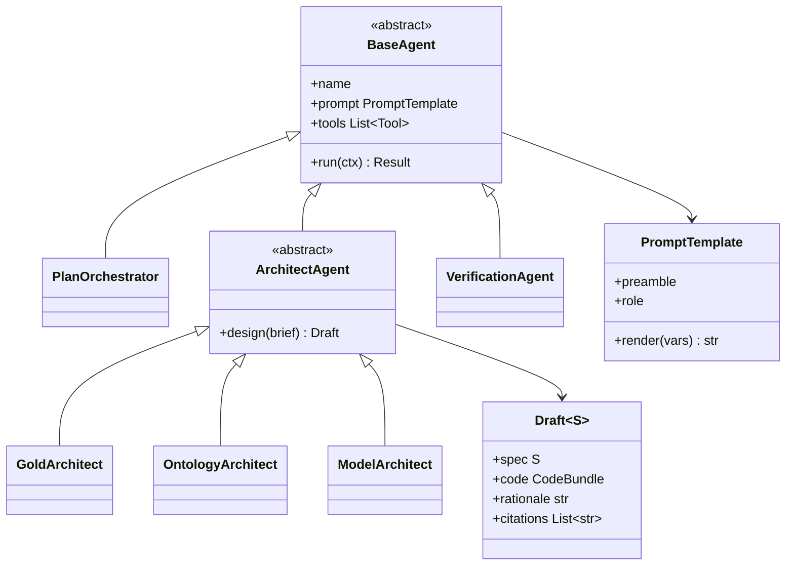

The agents that write a Project's Plan. They work in a ReAct (Reason + Act) loop on Vertex AI Agent Engine.

## Steps

- **Gather:** ask Orion for the raw data's schema and size, and read the regulations the user added.
- **Design:** draft the Golden Dataset tables, the Ontology and the predictive models.
- **Code:** write the PySpark pipeline, the Ontology creation and the CPU or GPU training code, starting from pre-written building blocks for data pipelines and model training.
- **Verify:** check all the code with formal verification and unit tests.
- **Review:** show the Plan to the user, apply their edits, and wait for approval.

## Data flow

## Software components

- **Google ADK** multi-agent app on **Vertex AI Agent Engine**, one deployment for all Plan agents.
- **Gemini 4 Argon** for every agent.
- **Plan store** in Cloud SQL: Plan versions, specs and code bundles.
- **Building blocks index:** a searchable catalogue of the pipeline and training blocks, with signatures and examples.

## Prompting and context engineering

- **One orchestrator, narrow specialists:** only the orchestrator sees the whole problem. Architects get a brief and a schema slice.
- **Shared typed contracts:** every agent returns a Pydantic spec, so outputs plug together without free-text parsing.
- **Blocks first:** each architect retrieves matching building blocks before writing code, and must justify any new code.
- **Same rules everywhere:** a shared rules preamble (no raw data, cite regulations, CPU or GPU only) is prepended to every agent's prompt.

## Low-level design

- `BaseAgent` wraps ADK's `LlmAgent` so every agent shares logging, the rules preamble and the auth check.
- `Draft` is generic over the spec type: `GoldSpec`, `OntologySpec` or `ModelSpec`.
