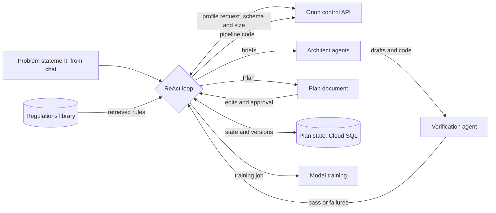
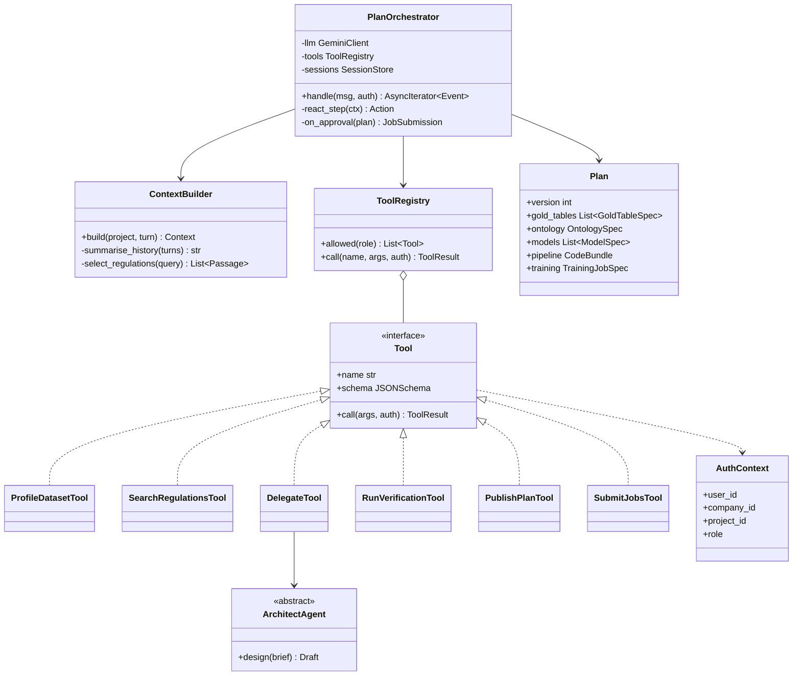

Runs the ReAct loop for a Plan. It starts when a user sends a problem statement through Agora, and it coordinates the three architect agents and the Verification agent.

## Steps

- **Profile the data:** asks Orion for the record count and the column-to-type mapping of each raw dataset.
- **Collect the rules:** reads the regulations the user added for the Project.
- **Delegate:** hands design work to the three architect agents.
- **Revise:** applies the user's edits and re-runs the affected steps.
- **Kick off:** on approval, sends the pipeline code to Orion and the training job to Merlin's model training.

## Data flow



## Software components

- **Google Agent Development Kit (ADK)**, Python, deployed on **Vertex AI Agent Engine**.
- **Gemini 4 Argon** on Vertex AI as the model, shared by all agents.
- **Agent Engine Sessions** for conversation state, **Memory Bank** for per-Project memory.
- **Vertex AI RAG Engine** over the regulations library.
- Tools: `profile_dataset`, `search_regulations`, `delegate`, `run_verification`, `publish_plan`, `submit_jobs`.
- **Cloud Trace** for every loop step.

## Prompting and context engineering

- **System prompt:** the agent's role, the Plan's JSON schema, and hard rules: never ask for row-level data, cite a regulation for every constraint, stop if verification fails three times.
- **Structured output:** the Plan is a typed JSON object, rendered into the Plan document. No free-text Plans.
- **Context per turn:** problem statement, dataset profiles (schema and counts only), top regulation passages with citations, the current Plan version, and the last verifier report.
- **Never in context:** raw data, secrets, other Projects.
- **Budget:** older turns are summarised. Architect outputs are referenced by ID, not pasted in full.
- **Delegation:** each architect gets a narrow brief and only the schema slice it needs.
- **Examples:** two or three worked Plans from the building-blocks library as few-shot examples.
- **Guardrails:** tool allow-list, a maximum number of loop steps, low temperature, user role checked through the Accounts API before acting.

## System prompt (excerpt)

```text
You are the Plan orchestrator for FourthSpace Project {project_name},
owned by {company_name}. You design a Plan that turns the company's raw
data into Golden Datasets, an Ontology and predictive models that help
them decide: "{problem_statement}".

You never see raw data. You only know each dataset's schema and size:
{dataset_profiles}

The Plan must comply with these regulations. Cite the passage ID for
every constraint you apply:
{regulation_passages}

Work in a loop: Reason about what is missing, Act with one tool call,
Observe the result. Delegate design work to the Golden Dataset, Ontology
and Model architects with a short brief and only the columns they need.
Build all code from the building blocks in {building_blocks_index};
write new code only when no block fits, and say why.

Rules:
- Never request row-level data, samples or secrets.
- Model training runs on CPU or GPU only, on anonymised data.
- Stop and report to the user if verification fails 3 times.
- Return the Plan only as JSON matching {plan_schema}.

Current Plan version: {plan_version}
Last verification report: {verifier_report}
```

## Low-level design



- **Tools are a Strategy:** each tool is one class behind the `Tool` interface. The registry filters them by the user's role.
- **ContextBuilder** is the only place context is assembled, so the "never raw data" rule is enforced in one class.
- **Plan** is an immutable Pydantic model. Every change makes a new version.
- **AuthContext** is passed into every tool call, never read from globals.
