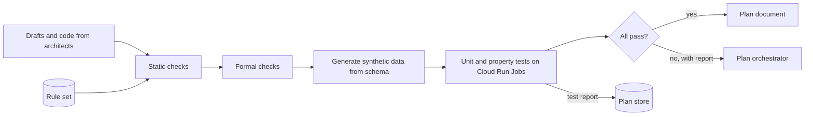
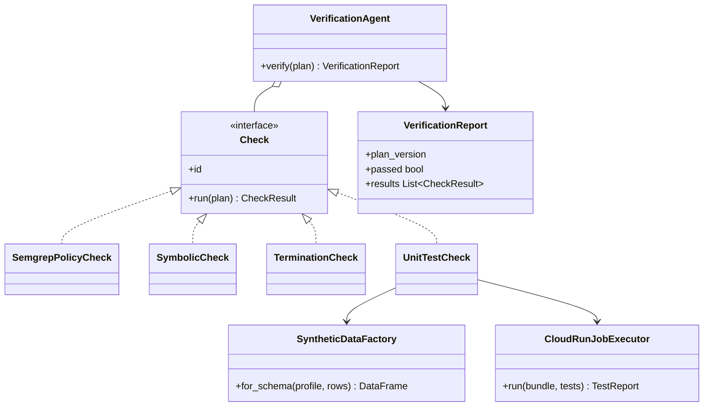

Checks every piece of code in the Plan before anyone runs it.

## Steps

- **Formal verification:** proves the pipeline has no runaway bugs and no processing that breaks the Project's regulations.
- **Unit tests:** cover the pipeline, the Ontology creation and the model training. They run on Cloud Run.
- **Hand-off:** sends the verified Plan to Agora for the user to review.

## Data flow



## Software components

- ADK `LlmAgent` on Agent Engine, Gemini 4 Argon, to read failures and write the report.
- **Semgrep** with FourthSpace rules generated from the rule set, for example "no forbidden field reaches a Gold column".
- **CrossHair** symbolic execution on stage functions, and a termination check on loops and joins.
- **pytest** and **Hypothesis** property tests, with **SDV** synthetic data built from the schema profile.
- Tests run in **Cloud Run Jobs**, small Spark in local mode, small model fits on CPU.

> **To confirm:** the formal verification tools. Semgrep rules and CrossHair are assumed here.

## Prompting and context engineering

- The checks are tools, not the model. The agent decides which checks to run and explains failures.
- **Context:** the Plan specs, the rule set, the tool results. Never the full code base, only the files a failing check points at.
- **Output:** a `VerificationReport` with each failure, the rule or test it broke, the file and line, and a suggested fix for the architect.
- **No self-grading:** the agent can't mark a check as passed; only tool results can.

## Prompt (excerpt)

```text
You verify Plan {plan_version}. Run every required check: {checks}.
You cannot pass a check yourself; only tool results count.
For each failure, cite the rule ID or test name, the file and line,
and suggest the smallest fix. Return VerificationReport JSON only.
```

## Low-level design


