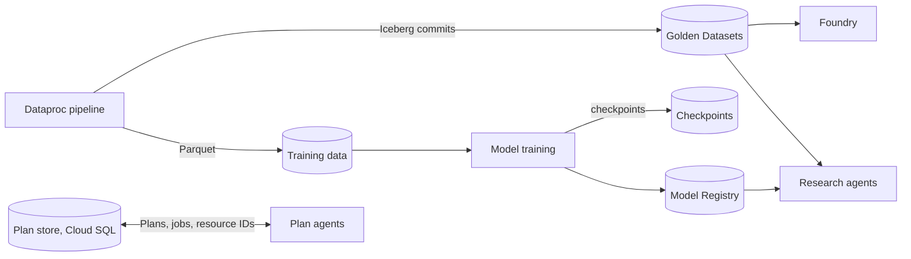
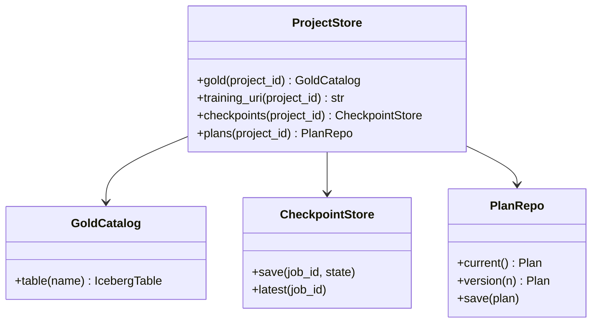

Everything a Project owns, stored on GCP. The Project's metadata, such as its owner company and users, is stored in Cloud SQL. Each Project has its own Golden Datasets, models and Ontology, and many users can work on the same Project.

## Data flow

## Software components

- **Cloud Storage** bucket `merlin-projects` with one prefix per Project.
- **BigLake metastore** as the Iceberg catalog.
- **Vertex AI Model Registry**.
- **Cloud SQL for PostgreSQL** (the same instance as the accounts database) for the Plan store.

## Configuration and metadata

- Layout: `{project_id}/gold/`, `{project_id}/training/`, `{project_id}/checkpoints/`, `{project_id}/reports/`.
- IAM per prefix through managed folders; each Project's service account sees only its own.
- Lifecycle: training data deleted 30 days after the models are registered; checkpoints after 14 days.
- Plan store tables: `plans`, `plan_versions`, `jobs`, `incidents`, `foundry_resources`, `reports`.
- CMEK on everything.

## Low-level design

- `ProjectStore` is the only way services build paths, so a Project can't read another's prefix by a typo.
