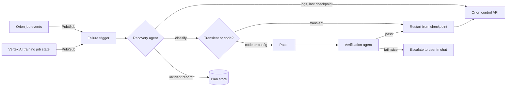
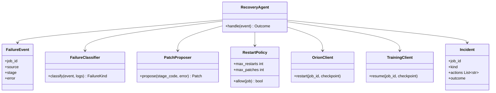

AI agents on Vertex AI that step in when something fails while a Project is being created.

## Steps

- **Audit:** read the failure from Orion's job runner.
- **Fix:** correct the code or configuration.
- **Restart:** resume from the nearest checkpoint rather than from the start.

## Data flow



## Software components

- ADK `LlmAgent` on **Vertex AI Agent Engine**, Gemini 4 Argon.
- **Pub/Sub** push subscription to a Cloud Run trigger that starts the agent.
- Tools: `get_job`, `get_logs`, `get_checkpoint`, `propose_patch`, `verify_patch`, `restart_job`, `restart_training`, `notify_user`.
- **Cloud Logging** API for job logs.

## Prompting and context engineering

- **Context:** the failed job record, the last 200 log lines around the error, the failing stage's code, the Plan spec for that stage. Not the whole Plan.
- **Classify first:** transient (quota, preemption, network) restarts unchanged; anything else needs a patch.
- **Patches are small:** one stage at a time, re-verified before restart. No changes to Gold schemas or anonymisation without user approval.
- **Limits:** at most 3 restarts per job and 2 patches per stage, then escalate.

## Prompt (excerpt)

```text
Job {job_id} for Plan {plan_version} failed at stage {stage}.
Error and logs: {log_excerpt}
Stage code: {stage_code}
Decide: TRANSIENT or CODE. For CODE, propose the smallest patch to
this stage only. Never change schemas or anonymisation settings.
Every patch must pass verify_patch before restart.
```

## Low-level design


