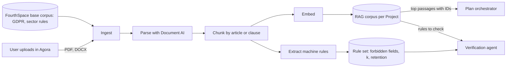
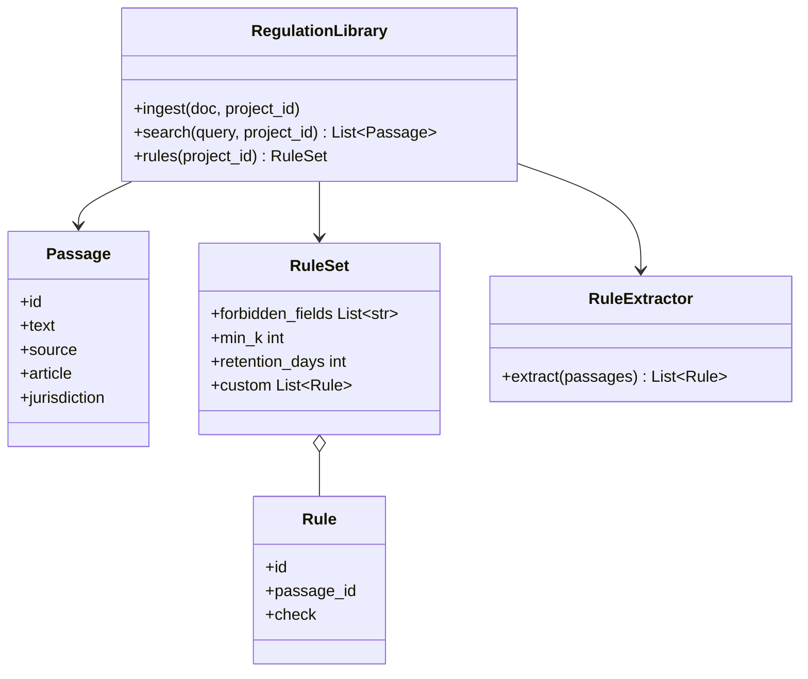

The legal rules the Project's Golden Datasets, Ontology and models must comply with, such as GDPR, sector regulations and the company's own policies.

The user adds them in Agora when they start the Project. The Plan orchestrator designs within them, and the Verification agent checks the code against them.

## Data flow

## Software components

- **Vertex AI RAG Engine**, one corpus per Project, plus a shared base corpus.
- **Document AI** layout parser for PDFs and Word files.
- **Vertex AI text embeddings**.
- A Gemini 4 Argon extraction step that turns clauses into machine-checkable rules.

## Configuration and metadata

- Chunk = one article or clause, with its heading path.
- Chunk metadata: source, jurisdiction, article ID, effective date, uploaded by.
- Retrieval: hybrid search, top 8 passages, reranked.
- Machine rules are stored as JSON and shown to the user in the Plan for confirmation.
- Per-Project corpora are deleted with the Project.

## Low-level design

- Every `Rule` links back to the `Passage` it came from, so a failed check can cite the law.
