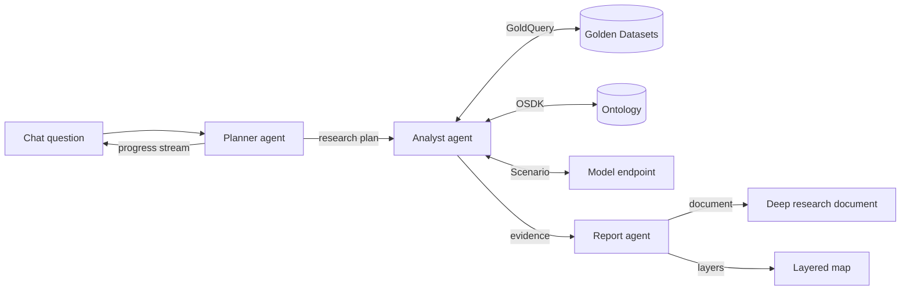
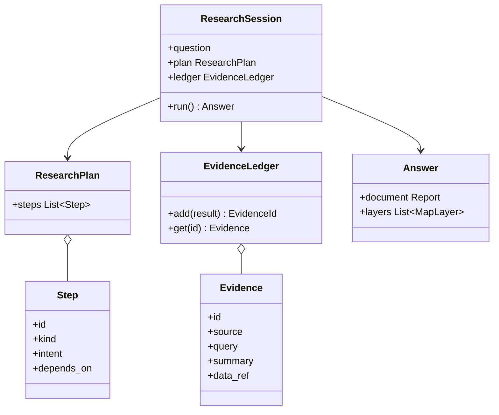

The agents that answer users' questions about a Project. They work in a ReAct loop on Vertex AI Agent Engine, and only ever read the Project's own data, Ontology and models.

## Steps

- **Plan:** break the question into steps.
- **Query:** read the Golden Datasets, the Ontology and the models.
- **Report:** check every claim is grounded, then write the deep research document and map layers.

## Data flow

## Software components

- **Google ADK** multi-agent app on **Vertex AI Agent Engine**, Gemini 4 Argon.
- **Agent Engine Sessions** per chat thread, **Memory Bank** per Project for earlier findings.
- Shared `fourthspace-auth` check on every tool call.

## Prompting and context engineering

- **Pipeline, not a free-for-all:** Planner, Analyst and Reporter each have one job and a typed hand-off.
- **Evidence ledger:** every query result gets an ID; only the ledger, not raw query output, moves between agents.
- **Grounding:** the Reporter can only state numbers that exist in the ledger.
- **Memory:** earlier answers in the Project are recalled as summaries with their evidence IDs.

## Low-level design

