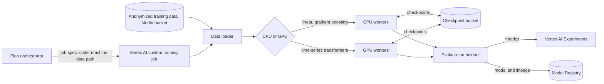
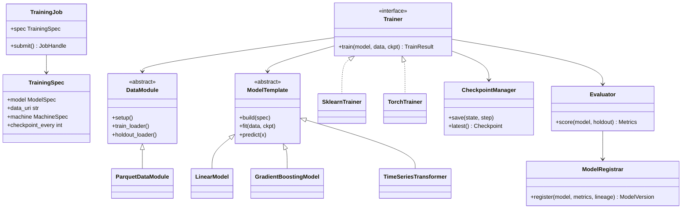

Trains the Project's predictive models on Vertex AI, on CPU or GPU only. It runs in Merlin, and it only ever sees training data that Orion has already anonymised.

## Steps

- **Start:** the Plan orchestrator submits the approved training job.
- **Load:** reads the anonymised training data from Merlin's training bucket.
- **Train:** CPU for classical models, GPU for deep models. Checkpoints often.
- **Evaluate:** scores each model on a holdout set.
- **Register:** saves the model, metrics and lineage to the Model Registry.

## Data flow

## Software components

- **Vertex AI custom training** with prebuilt **PyTorch 2** and **scikit-learn** containers.
- **FourthSpace training building blocks**, a Python package of data loaders, model templates and training loops.
- **LightGBM** and **statsmodels** for classical models.
- **Vertex AI Experiments** for runs and metrics, **Model Registry** for versions.

## Configuration and metadata

- Machines: `n2-standard` for CPU jobs, `g2-standard` with NVIDIA L4 GPUs for deep models. No TPUs.
- The Model architect picks the machine from the profiled data size.
- One service account per Project. Reads only that Project's prefix in the training bucket.
- Checkpoints every N steps to Cloud Storage, so recovery agents can restart a failed job.
- Each registered model records: Plan version, training data hash, code commit, metrics, machine type.
- Encrypted with a customer-managed key (CMEK).

## Low-level design

- **ModelTemplate** subclasses are the training building blocks. The Model architect picks one and sets its hyperparameters.
- **Trainer** is chosen by model type: `SklearnTrainer` on CPU, `TorchTrainer` on CPU or GPU.
- **CheckpointManager** makes every job resumable, so recovery agents restart from `latest()`.
- **ModelRegistrar** always writes lineage with the model.
