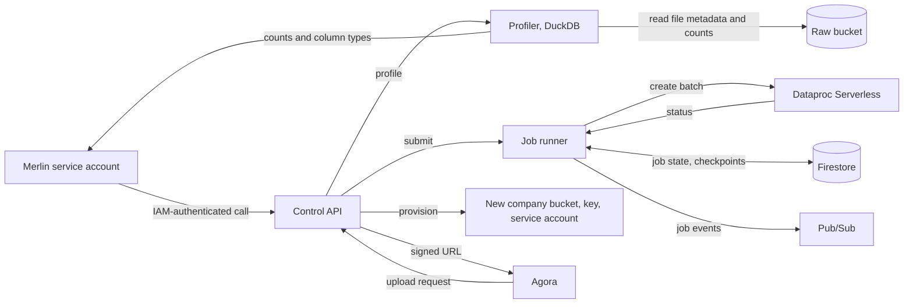
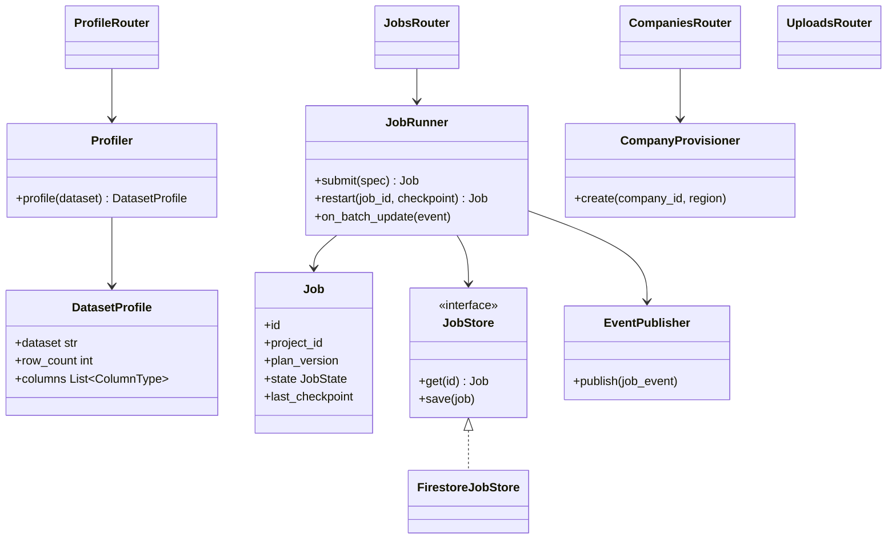

The single entry point Merlin uses to work with Orion. It runs on Cloud Run.

## Steps

- **Schema profiling:** returns the number of records and a mapping of each column name to its type, so the Plan agents can design without seeing the raw data.
- **Job runner:** receives the approved PySpark pipeline, starts it on Dataproc Serverless, and records checkpoints.
- **Company buckets:** creates a new company's raw data bucket when the Accounts API asks.
- **Status:** reports progress and failures, which recovery agents use to restart work.

## Data flow

## Software components

- **Python 3.12, FastAPI**, on **Cloud Run**.
- **DuckDB** for profiling: reads Parquet footers and CSV headers, counts rows. Never returns values.
- **Dataproc Batches API** client.
- **Firestore** for job state, **Pub/Sub** for job events.

## Configuration and metadata

- Ingress: internal only, plus the Agora upload endpoint behind the load balancer.
- Callers allowed: Merlin's Plan, recovery and accounts service accounts, checked by IAM.
- Endpoints: `POST /profile`, `POST /jobs`, `GET /jobs/{id}`, `POST /jobs/{id}/restart`, `POST /companies`, `POST /uploads`.
- Profile output schema is fixed: dataset, row count, columns with name and type. No sample values.
- Job record: job ID, Project, Plan version, code commit, batch ID, state, last checkpoint, error.
- Signed upload URLs expire after 15 minutes.

## Low-level design

- `DatasetProfile` has no field that can hold a data value, so a sample can't leak by mistake.
- `JobRunner` is the only class that talks to Dataproc.
