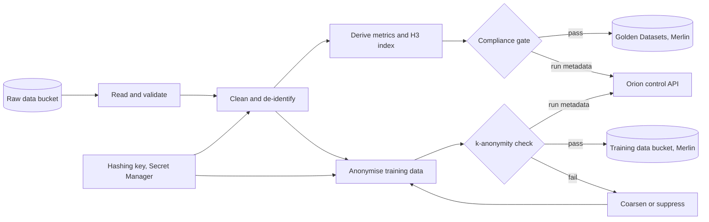
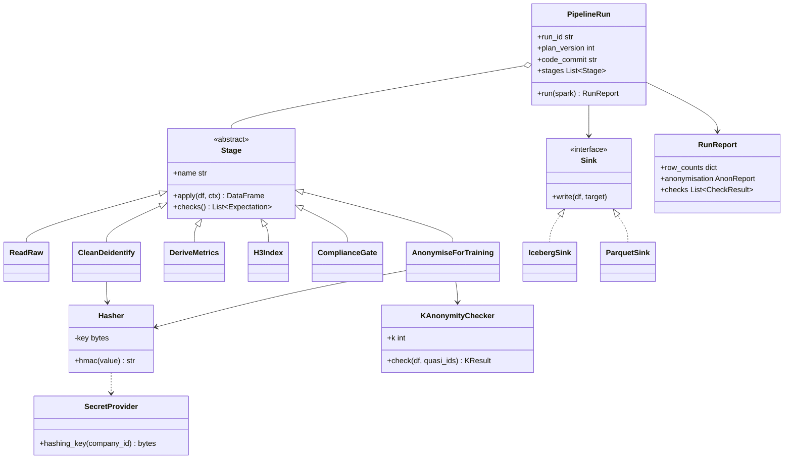

Runs the Plan's PySpark pipeline inside Orion. It builds the Golden Datasets and anonymises a separate copy of the data for model training. Raw data never leaves Orion.

## Steps

- **Clean and de-identify:** removes or hashes personal identifiers.
- **Derive metrics:** computes the signals that drive the decision.
- **Spacetime-H3 indexing:** keys every record by H3 cell and time bucket.
- **Compliance gate:** checks the output against the Project's regulations.
- **Anonymise training data:** pseudonymises, coarsens and checks k-anonymity before it goes to Merlin.

## Data flow

## Anonymisation of training data

- Drops direct identifiers: names, emails, phone numbers, device IDs.
- Replaces remaining IDs with keyed hashes (HMAC-SHA256), key from Secret Manager.
- Coarsens location to an H3 cell and time to an hour or day.
- Suppresses any group smaller than k = 10.
- Writes an anonymisation report with the run's metadata.

## Software components

- **Dataproc Serverless for Spark**, runtime 2.2, Python 3.11, PySpark.
- **FourthSpace pipeline building blocks**, a Python wheel of tested transforms.
- **Apache Iceberg** Spark runtime, **H3** for indexing.
- **Great Expectations** for data quality checks.

## Configuration and metadata

- One batch per pipeline run, started by the Orion control API.
- Runs as the company's own service account: read its raw bucket, write the Project's Golden Dataset and training data paths in Merlin, read the hashing key.
- Inside a VPC Service Controls perimeter, private IPs only.
- Executor count scaled from the profiled data size.
- Run metadata: batch ID, Plan version, code commit, input versions, row counts in and out, anonymisation report.
- Spark logs kept on a Persistent History Server.

## Low-level design

- **Stages come from the building blocks.** The agents compose a `PipelineRun` from existing `Stage` classes and only write new subclasses when none fits.
- Each stage declares its own **data quality checks**, run after `apply`.
- **Sinks** decide where output goes: Iceberg for Golden Datasets, Parquet for training data.
- The hashing key is injected through `SecretProvider`, never hard-coded or logged.
