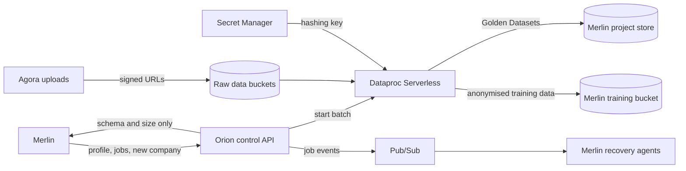
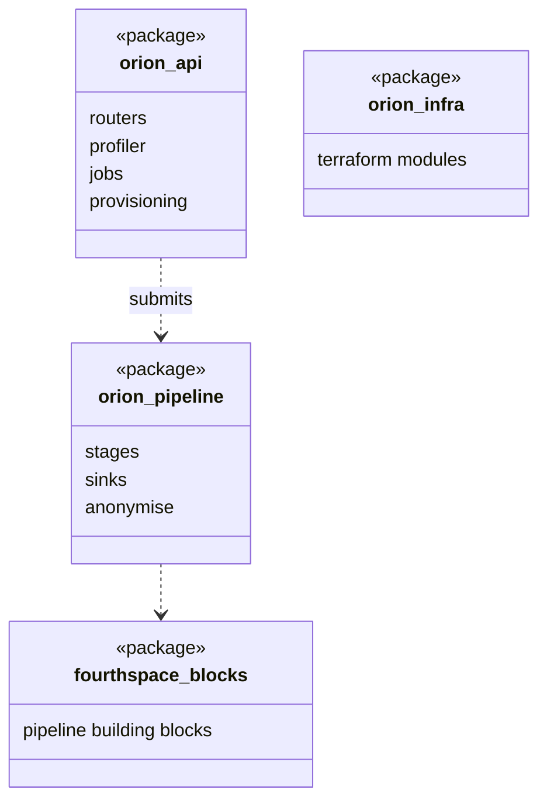

The customer's data and compute boundary on GCP. Raw data stays inside Orion: Merlin sends it code to run and receives only the outputs, such as schemas, Golden Datasets and anonymised training data.

## Responsibilities

- Holds each company's raw data.
- Describes the raw data's schema and size when Merlin plans a Project.
- Runs the Plan's PySpark pipeline on Dataproc Serverless.
- Anonymises the training data before it leaves for Merlin, where the models are trained.

## Data flow

## Software components

- One GCP project for Orion, inside a **VPC Service Controls** perimeter.
- **Cloud Storage**, **Secret Manager**, **Cloud Run**, **Dataproc Serverless**, **Firestore** for job state, **Pub/Sub** for job events.
- **Cloud KMS** keys (CMEK) for every store.
- **Terraform** for all of it, applied by Cloud Build.

## Configuration and metadata

- Per company: one raw data bucket, one service account, one hashing key.
- Only two paths out of the perimeter: Golden Datasets and anonymised training data, both to Merlin.
- Merlin reaches Orion only through the control API, using a service account with no data access.
- Data Access audit logs on for every bucket and secret.

## Low-level design

- Two deployable units: the control API image and the pipeline wheel.
- The pipeline package depends on the building blocks; the API only submits it.
