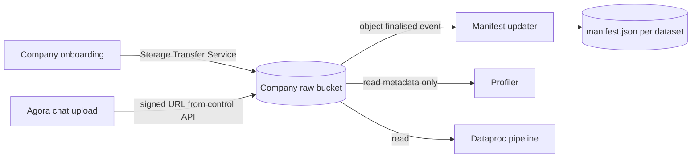
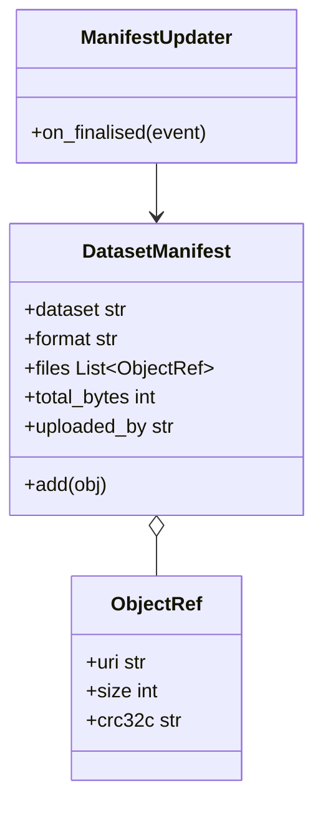

Cloud Storage buckets holding each company's raw input data, such as location pings, sensor readings, transactions or weather records.

Data usually arrives during company onboarding, so a new Project can reuse it. Users can also upload more raw data through Agora when they start a Project.

## Notes

- Raw data never leaves Orion.
- Each company's data sits in its own bucket.

## Data flow

## Software components

- **Cloud Storage**, one bucket per company.
- **Storage Transfer Service** for bulk onboarding from S3, Azure or SFTP.
- **Eventarc** trigger on new objects to update the dataset manifest.

## Configuration and metadata

- Name: `orion-raw-{company_id}`, in the company's chosen region.
- Uniform bucket-level access, public access prevention on, CMEK.
- Object versioning on, with a 30-day soft-delete window.
- Layout: `datasets/{dataset}/{upload_date}/part-*.parquet` (CSV and JSON also accepted).
- Read by: the company's pipeline service account and the profiler. Written by: signed URLs and Storage Transfer.
- Each dataset's `manifest.json`: name, format, files, total bytes, uploaded by, upload time.

## Low-level design

