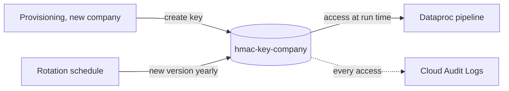
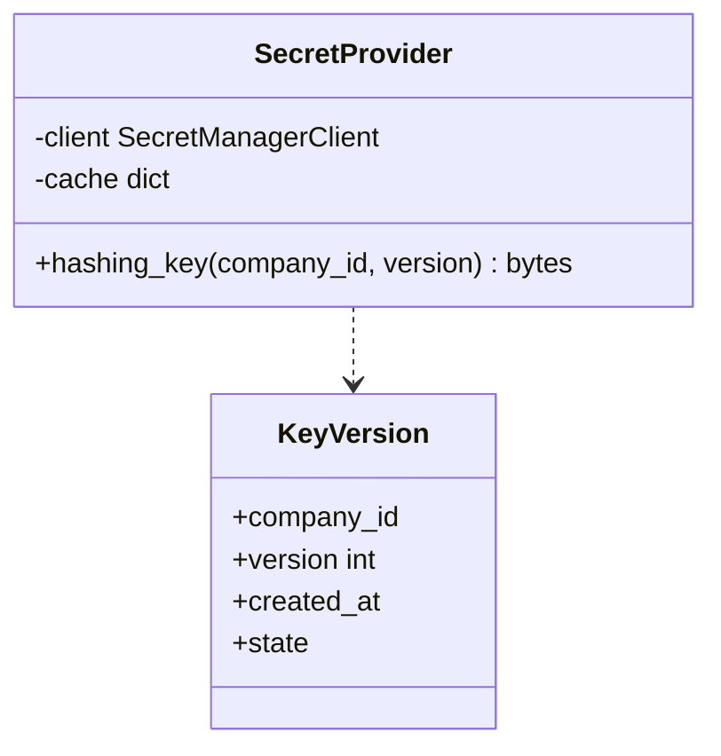

GCP Secret Manager holds the keys the pipeline needs, such as the hashing secret used to de-identify records, and service credentials.

The pipeline reads keys at run time, so they never appear in the Plan's code.

## Data flow

## Software components

- **GCP Secret Manager**, regional replication.
- **Cloud KMS** for the customer-managed key that encrypts the secrets.
- **Cloud Scheduler** and Pub/Sub for rotation reminders.

## Configuration and metadata

- One HMAC key per company: `hmac-key-{company_id}`, 256-bit random.
- Rotation: new version yearly. Old versions stay enabled so earlier pseudonyms can still be joined, then are disabled after the Project ends.
- Access: only the company's pipeline service account has `secretAccessor`. Merlin has none.
- Labels: `company_id`, `purpose=pseudonymisation`.
- Every access is logged in Data Access audit logs.

## Low-level design

- `SecretProvider` caches a key only in memory for one pipeline run and never logs it.
