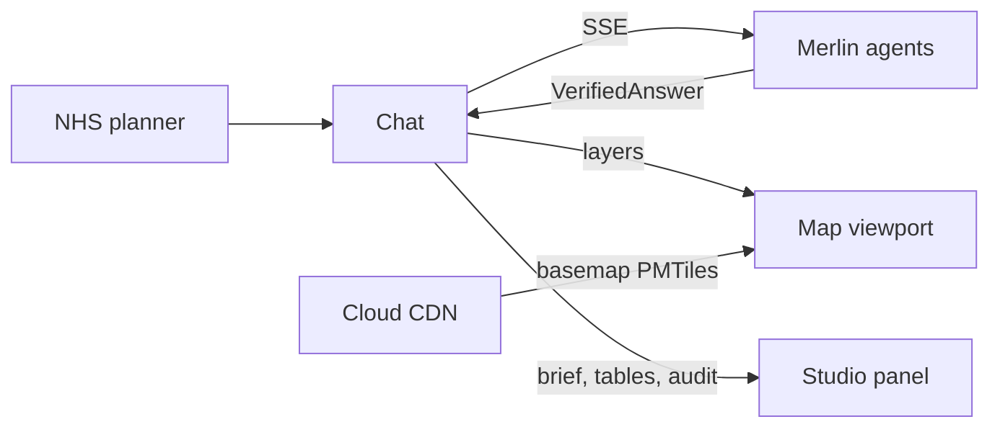
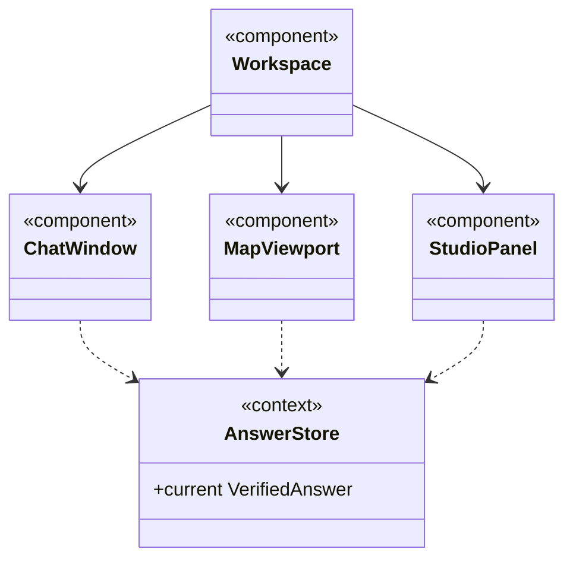

Agora provides the interactive multi-window workspace for NHS planners and analysts: an LLM chat interface with side windows for the map and the deep research output.

## Data flow

## Software components

- **Next.js (React, TypeScript)** on **Cloud Run**, **shadcn/ui** and **Tailwind CSS**.
- **MapLibre GL JS**, **deck.gl**, **pmtiles**.
- HTTPS load balancer with **Cloud CDN** for basemap tiles.

## Configuration and metadata

- MVP access: NHS users sign in with **Identity-Aware Proxy** and Google or Microsoft accounts on an allow-list.
- The app stores nothing; answers and briefs live in Merlin.

> **To confirm:** IAP allow-list sign-in for the MVP, instead of Platform's full Accounts service.

## UI components

- **Layout:** chat on the left, map and studio stacked on the right, resizable.

## Low-level design

- `AnswerStore` is how the chat "drives" the side windows: they render whatever answer is current.
