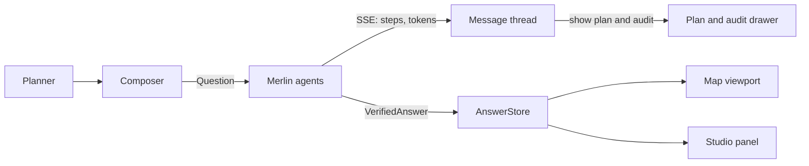
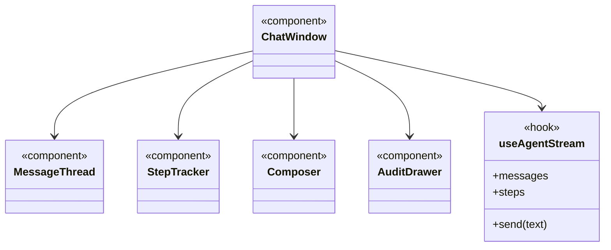

The main window for working with the copilot. For example, a planner might ask: *"Find the optimal health van location in Barking & Dagenham for weekday afternoons"*.

## Steps

- Accepts natural language queries
- Streams real-time copilot answers
- Shows execution plans and audit logs
- Drives the map and research side windows

## Data flow

## UI components

- **Message thread:** streamed answers with evidence chips.
- **Step tracker:** Planner, Analyst, Verifier progress.
- **Composer:** text box and suggested Snow questions.
- **Plan and audit drawer:** the QueryPlan and the 7 check results.
- **Verified badge:** shown only on answers that passed the Verifier.

## Software components

- Next.js, **shadcn/ui**, a custom `useAgentStream` hook over server-sent events, **react-markdown**.

## Low-level design

