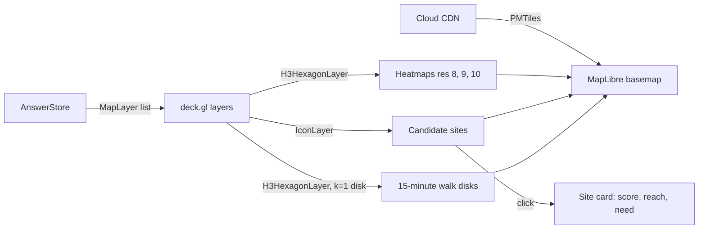
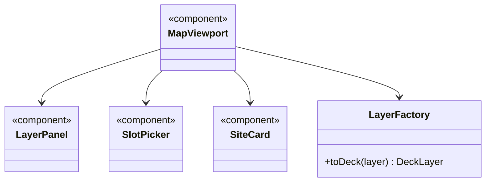

A side window built on the **MapLibre and Deck.gl** 3D map renderer, using **PMTiles** for map tiles.

## Displays

- Dynamic H3 resolution 8, 9 and 10 hexagon heatmaps
- Candidate van site markers
- 15-minute walking isochronous disk overlays

## Data flow

## UI components

- **Map canvas** with 3D extrusion toggle.
- **Layer panel**, **legend**, **slot picker** (weekday or weekend, hour).
- **Site card:** score breakdown, parking, power, link to the brief.

## Software components

- **MapLibre GL JS**, **pmtiles**, **deck.gl**, **h3-js**.

## Configuration and metadata

- Basemap: Protomaps PMTiles extract for the Thames Freeport area, on Cloud CDN.
- Layers come from the verified answer only, never from the CDN.
- Default view: centred on the 3 boroughs, zoom 11.

## Low-level design

