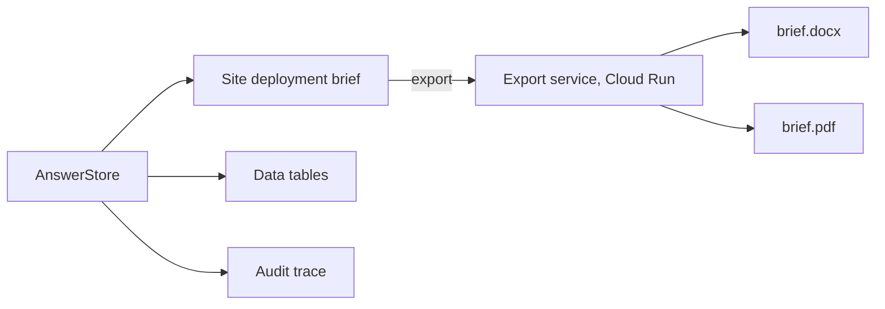
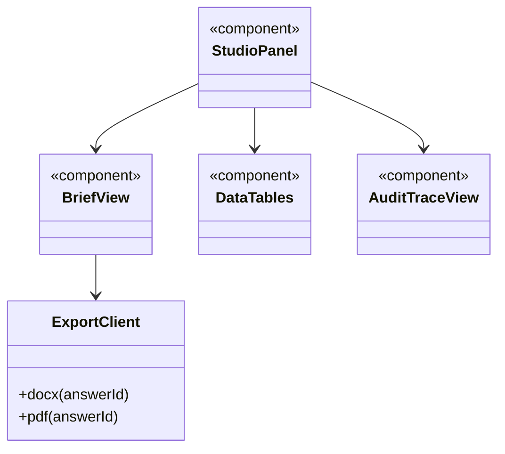

A side window for the deep research output.

## Displays

- Downloadable site deployment briefs (`.docx` and `.pdf`)
- Detailed data tables
- Verifier audit traces

## Data flow

## UI components

- **Brief view:** recommended sites, times, reach, need, method and limitations.
- **Tables:** sortable, CSV download.
- **Audit trace:** each of the 7 checks with pass or fail and the Model Armor verdict.
- **Export buttons:** Word and PDF.

## Software components

- Next.js, **shadcn/ui**, **TanStack Table**.
- Export service on **Cloud Run**: **docx** (npm) for Word, headless Chrome for PDF.

## Configuration and metadata

- Briefs include the data date range, the k ≥ 5 note and the Verifier's audit ID.
- Exports are generated on request and not stored.

## Low-level design

