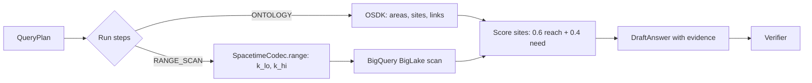
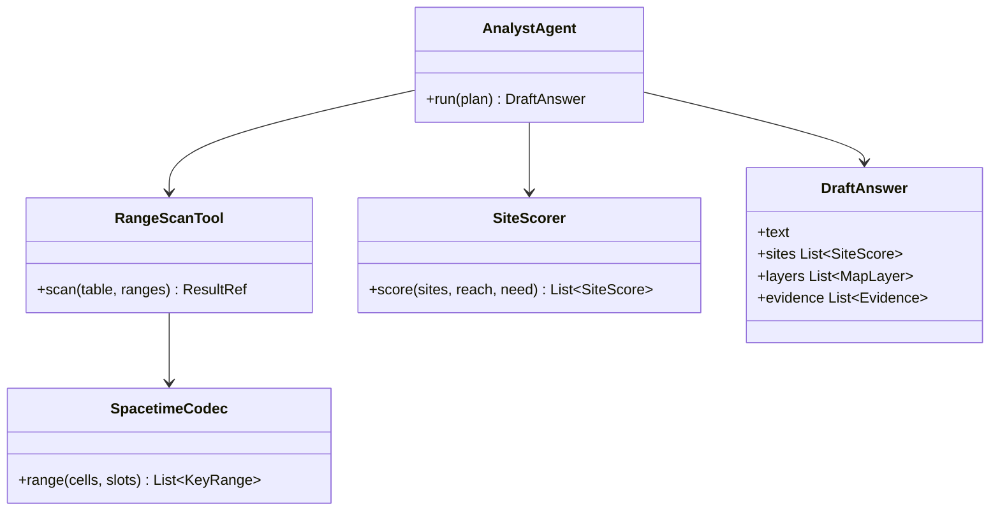

Queries `[Snow] Area` and `[Snow] Candidate Site` objects in the Ontology.

Also translates spatial requirements into contiguous 64-bit `spacetime_key` range scans (`[k_lo, k_hi]`) over BigQuery BigLake tables.

## Data flow



## Software components

- ADK `LlmAgent`, Gemini 4 Argon.
- Tools: `query_ontology` (OSDK), `range_scan` (BigQuery, read-only, bytes cap), `score_sites` (deterministic Python).
- `snow_spacetime.SpacetimeCodec` to build key ranges.

## Prompting and context engineering

- **Typed tools only:** the model picks cells and slots; code builds the key ranges and SQL.
- **Scores are computed, not generated:** `score_sites` applies the formula; the model only explains it.
- **Evidence IDs:** every result is stored with an ID; the draft answer cites them.

## Prompt (excerpt)

```text
Run this QueryPlan: {query_plan}
Use query_ontology for areas and sites, range_scan for footfall
and dwell, and score_sites for rankings. Never compute a score
yourself. Cite evidence IDs for every number.
```

## Low-level design


