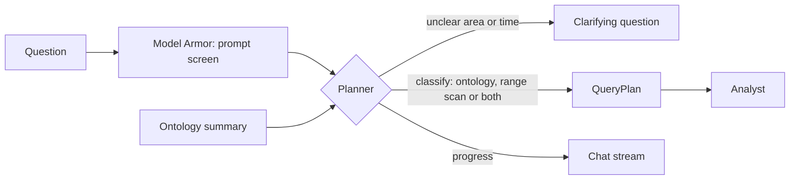
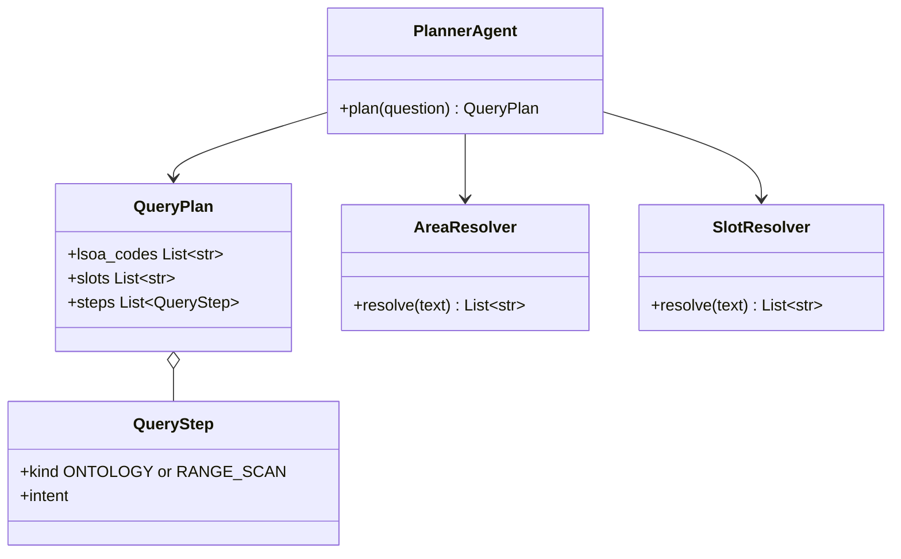

Classifies natural language prompts into spatial and ontological queries, then routes actions to Ontology tools or BigQuery.

Inspects `[Snow]` object properties and follows graph links through read queries.

## Data flow



## Software components

- ADK `LlmAgent`, Gemini 4 Argon.
- Tools: `ontology_summary`, `resolve_area` (place names to LSOA codes), `resolve_time` (phrases to slots), `ask_user`, `emit_progress`.

## Prompting and context engineering

- **Context:** the question, the 4 object types and 3 links with key properties, the LSOA list for the 3 boroughs, the slot calendar.
- **Resolve, don't guess:** places become LSOA codes and times become slot IDs through tools.
- **Output:** strict JSON `QueryPlan`.

## Prompt (excerpt)

```text
You plan queries for Project Snow: mobile health van placement in
Barking & Dagenham, Havering and Thurrock.
Ontology: {ontology_summary}
Turn the planner's question into a QueryPlan. Resolve places with
resolve_area and times with resolve_time. If the area or time is
missing, call ask_user once. Never plan queries about individuals.
```

## Low-level design


