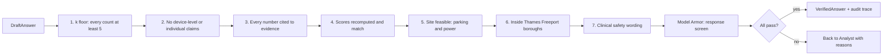
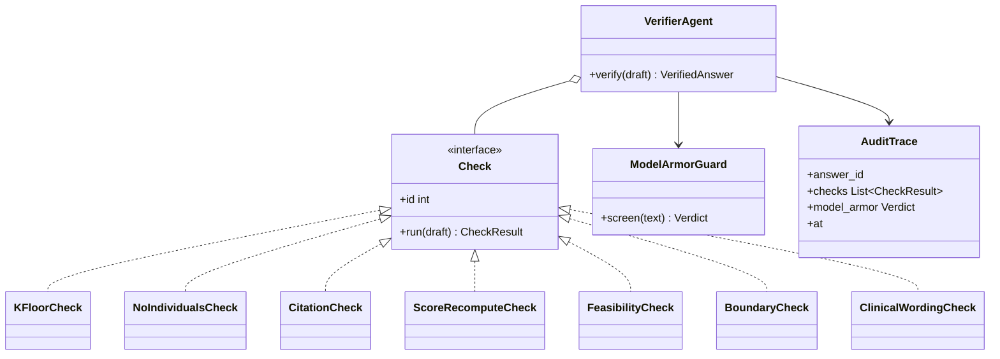

Runs 7 deterministic heuristic verification checks and Model Armor policy guardrails to validate clinical safety, privacy compliance and site feasibility.

## Data flow



## Software components

- ADK `LlmAgent`, Gemini 4 Argon, only for check 7 and writing the reasons.
- Checks 1 to 6 are deterministic Python.
- **Model Armor** templates: prompt injection, sensitive data, harmful content.
- Audit traces written to BigQuery `snow_audit`.

> **To confirm:** the list of 7 checks. This list is assumed from the existing description.

## Prompting and context engineering

- **Code first:** the model can't override a failed deterministic check.
- **Check 7 prompt:** compares wording with a short DCB0129 hazard list, such as "no diagnostic claims" and "advise, don't direct".
- **Context:** the draft answer, evidence summaries, check results. Not the Analyst's reasoning.

## Prompt (excerpt)

```text
Check this answer for clinical safety wording only: {draft_text}
Hazards to avoid: {hazard_list}
Return PASS or FAIL with the sentence and hazard ID for each issue.
Checks 1-6 have already run: {check_results}. You cannot change them.
```

## Low-level design


