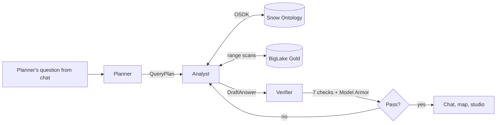
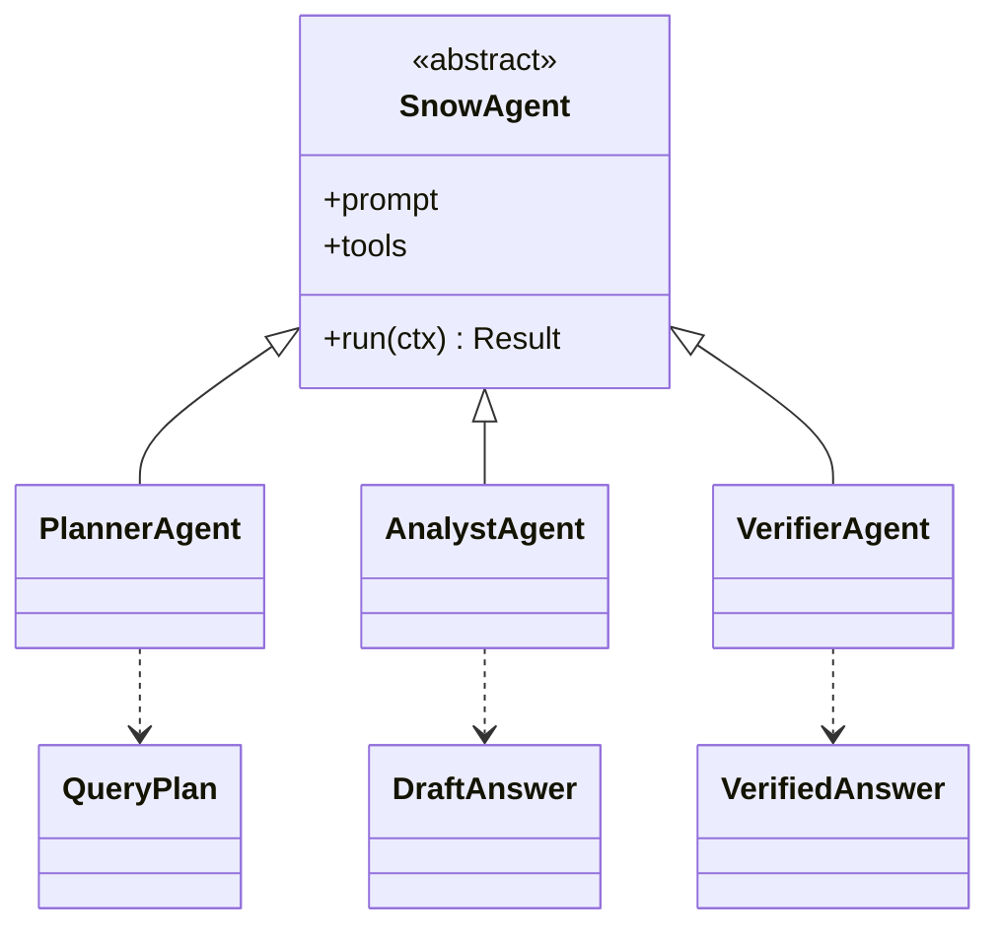

The AI layer uses Vertex AI Agent Engine with the GCP multi-agent SDK and Gemini, following a multi-agent approach.

## Steps

- **Planner Agent:** classifies the question, routes it and inspects Ontology properties and links.
- **Analyst Agent:** queries `[Snow] Area` and Candidate Sites, and runs range scans.
- **Verifier Agent:** checks safety, privacy and feasibility.

## Data flow

## Software components

- **Google ADK** multi-agent app on **Vertex AI Agent Engine**.
- **Gemini 4 Argon** for all three agents.
- **Model Armor** on prompts and responses.
- **Agent Engine Sessions** per chat thread.

## Prompting and context engineering

- **Fixed pipeline:** Planner, then Analyst, then Verifier. No agent can skip the Verifier.
- **Ontology first:** agents read objects and links; raw SQL only as `spacetime_key` range scans built by code.
- **Small context:** an Ontology summary, the question, and evidence summaries with IDs. Never full tables.
- **Snow rules preamble** on every agent: k ≥ 5, no device-level claims, Thames Freeport only, NHS clinical safety wording.

## Low-level design

