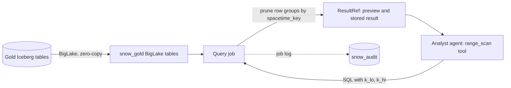
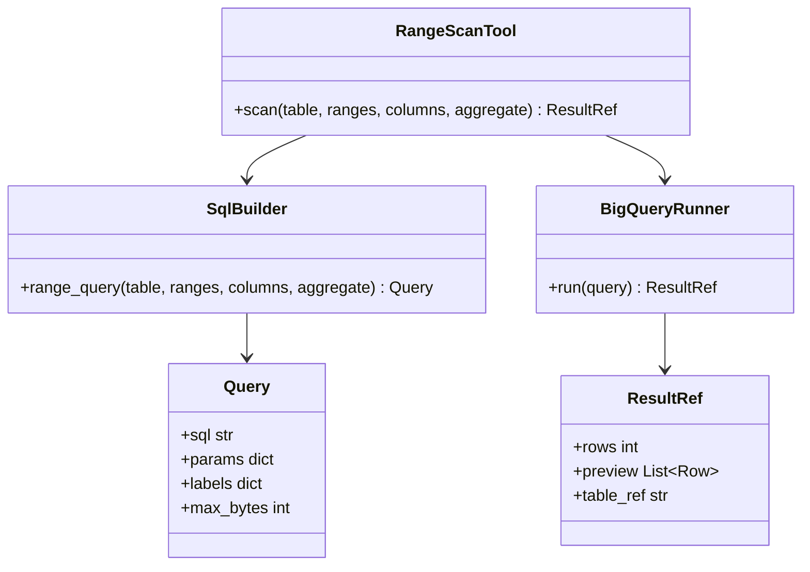

BigQuery is the SQL engine the agents use for fast range scans over the Gold data. It reads the Iceberg tables in the lakehouse through BigLake, without copying them.

## Steps

- **Expose:** one BigLake table per Gold table, in dataset `snow_gold`.
- **Scan:** `spacetime_key` range scans, pruned by Parquet row-group metadata.
- **Limit:** read-only access with a per-query bytes cap.
- **Audit:** every agent query is logged.

## Data flow

## Software components

- **BigQuery** with **BigLake** Iceberg tables and **BigLake metastore**.
- A BigQuery **Cloud resource connection** for reading the Gold bucket.
- Dataset `snow_audit` for agent query logs and Verifier audit traces.

## Configuration and metadata

- Location: `europe-west2`, same as the Gold bucket.
- Datasets: `snow_gold` (read-only BigLake tables), `snow_audit` (append-only), `snow_results` (query results, 7-day expiry).
- Agents' service account: `bigquery.dataViewer` on `snow_gold`, `jobUser` on the project, nothing else.
- Every query has `maximum_bytes_billed` of 10 GB and is labelled with the session ID and answer ID.
- Metadata caching on for the BigLake tables, refreshed after each daily Gold commit.
- On-demand pricing for the MVP.

## Low-level design

- `SqlBuilder` only builds parameterised queries with `spacetime_key BETWEEN @k_lo AND @k_hi`, so the model never writes SQL.
