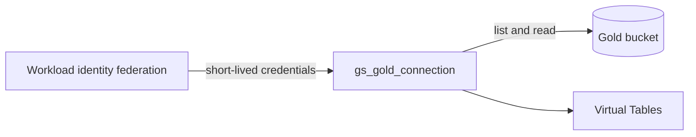
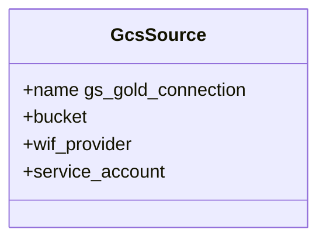

The GCS Data Connection (`gs_gold_connection`) is a secure, read-only integration path directly in Google Cloud Storage.

## Data flow

## Software components

- **Foundry Data Connection**, Google Cloud Storage source.
- **GCP Workload Identity Federation**: no stored service account key.

## Configuration and metadata

- Read-only, whole Gold bucket.
- GCP principal: `foundry-snow`, role `storage.objectViewer`.
- Foundry egress IPs allow-listed in the perimeter.

## Low-level design

