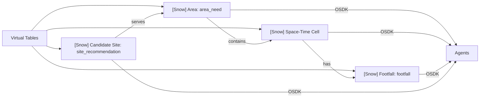
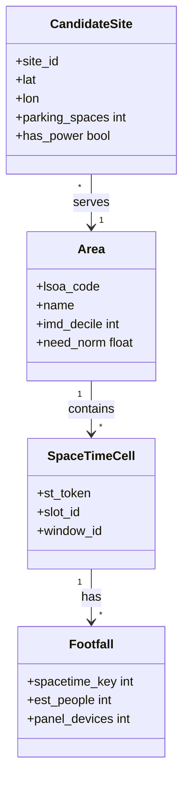

Defined in Ontology Manager. New Gold data landing in the lake is written through to these objects and links, and agents read from them.

## Object types

- **`[Snow] Area`:** LSOA code, ONS LSOA boundaries, Census 2021 demographics, IoD 2025 deprivation deciles (`imd_decile`) and calculated area need scores (`need_norm`).
- **`[Snow] Space-Time Cell`:** H3 resolution 9 spatial tokens (`st_token`) mapped to local time slots (`slot_id`) and `window_id`.
- **`[Snow] Footfall`:** k-anonymized estimated daily population footfall and panel device counts, enforcing the k ≥ 5 floor.
- **`[Snow] Candidate Site`:** Site ID, centroid latitude and longitude, parking space, power access (`has_power`) and physical constraints.

## Graph links

- `[Snow] Area` to `[Snow] Space-Time Cell`
- `[Snow] Space-Time Cell` to `[Snow] Footfall`
- `[Snow] Candidate Site` to `[Snow] Area`

## Data flow

## Software components

- **Foundry Ontology Manager**, **OSDK** (Python).

## Configuration and metadata

- Primary keys: Area `lsoa_code`; Space-Time Cell `st_token` + `slot_id`; Footfall `spacetime_key`; Candidate Site `site_id`.
- Footfall objects only exist for cells that passed the k ≥ 5 floor.

## Low-level design

